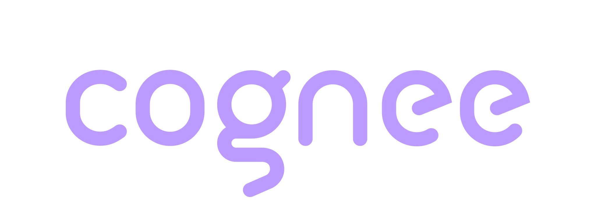

<div align="center">
  <a href="https://www.cognee.ai">
    
  </a>
  <p><strong>Cognee memory for Claude Code</strong> — persistent knowledge-graph memory with automatic capture of prompts and tool traces, and relevant recall on every turn.</p>
  <p>
    <a href="https://docs.cognee.ai">Docs</a> ·
    <a href="https://discord.gg/NQPKmU5CCg">Discord</a> ·
    <a href="https://github.com/topoteretes/cognee">Cognee core</a>
  </p>
</div>

# Cognee Memory for Claude Code

Adds persistent memory to Claude Code through Cognee.

The integration:
- captures prompts, tool traces, and assistant responses into session memory
- injects relevant context on prompt submit
- syncs session memory into graph memory on session end/final exit

## What this plugin runs, stores and sends

Everything below is the plugin's own readable Python and shell under this folder; it
runs no code from anywhere else.

**Captured.** Your prompts, the tool calls Claude makes (name, arguments and output,
filtered by the [capture controls](#automatic-capture-controls)), and Claude's
answers, plus a short memory anchor before compaction. Credentials, private keys and
database URLs are redacted before anything is stored or uploaded, and `.env`,
credential and key files are never captured. Text you wrap in `<private>…</private>`
never leaves the hooks; see [private spans](#private-spans). `COGNEE_CAPTURE=false` turns automatic
capture off; recall and explicit remember keep working.

**Where it goes.** To the Cognee server you configure, and nowhere else.
- *Local mode* (default): a cognee server the plugin starts on this machine, bound
  to `localhost:8011`. Memory is stored on this machine. To build the graph, that
  server sends captured text to the LLM and embedding provider you configured
  (the LLM API key plugin option, `LLM_PROVIDER`), or to Claude Code through the
  observer below.
- *Cloud mode*: your Cognee Cloud instance at the Cognee Cloud URL plugin option
  (or `COGNEE_BASE_URL`), over HTTPS, authenticated with the Cognee Cloud API key
  plugin option. The status line's credit balance comes from the Cognee platform
  API (`api.aws.cognee.ai`).

Memory is kept until you delete it (the `cognee-forget` skill, or deleting the
dataset). The plugin never expires server-side memory on its own.

**Other network calls.** Local mode installs `cognee==1.6.6` from PyPI into
`~/.cognee-plugin/venv` once. The install is `scripts/session-start.py`, which runs
`uv pip install` with that pinned version (a `uv` already on PATH, or the copy an
earlier plugin version left under `~/.cognee-plugin/uv`), or `python -m pip install`
in a venv built from a Python 3.10–3.14 already on the machine when there is no
`uv`. Neither `uv` nor a Python is ever downloaded, and nothing fetched is piped
into a shell. Cloud mode installs nothing. The background idle watcher fetches this
repository's `marketplace.json` from `raw.githubusercontent.com` at most hourly to
offer updates (`COGNEE_UPDATE_CHECK=off`). No telemetry, no analytics: nothing is sent to
Anthropic, Cognee or any third party beyond the calls above.

**Claude settings.** In cloud mode the plugin disables native auto-memory unless
you explicitly enabled it, keeping an ownership marker and previous value for
restoration. Set `COGNEE_DISABLE_AUTO_MEMORY=false` to opt out. Existing memory
files are retained. See [Memory preference](#memory-preference).

**Stored locally.** `~/.cognee-plugin/claude-code/` (logs, status markers, buffered
turns, swept automatically; see [Logs and state](#logs-and-state)),
`~/.cognee-plugin/venv/`, and your settings in `~/.cognee/.env`. No API key is
written to disk.

**Settings it writes.** One entry: session start installs the `statusLine` entry in
`~/.claude/settings.json` that draws the Cognee line below the prompt, and refreshes
it when the plugin moved. Only an entry whose command runs the plugin's own
`cognee-statusline.sh` is ever written or replaced; a status line you set yourself
is never touched. `COGNEE_STATUSLINE=0` stops it. Nothing else in your Claude Code
settings is touched. See [Status line](#status-line).

**Claude's own files.** The plugin reads the hook payloads Claude Code sends it, not
your transcript or Claude Code's memory files, and writes to neither.

**No code inside Claude Code.** The plugin has no hooks module (mod). It runs as
hook commands, skills and an agent, and every script they start is a separate
process from this folder.

**Background processes.** Detached helpers that outlive a hook: the idle watcher and
exit watcher (session sync and status), and in local mode the cognee server and,
when enabled, the Claude observer shim. All are scripts from this folder.

**Credentials it reads.** The Cognee Cloud API key and the LLM API key come only
from the plugin's options. Claude Code keeps them in its secure credential store
and passes them to the plugin's hook processes as
`CLAUDE_PLUGIN_OPTION_COGNEE_API_KEY` and `CLAUDE_PLUGIN_OPTION_LLM_API_KEY`. A
`COGNEE_API_KEY` or `LLM_API_KEY` in the shell or in `~/.cognee/.env` is ignored.
The Cloud URL comes from the Cognee Cloud URL option, or else from `COGNEE_BASE_URL`
in `~/.cognee/.env` or the environment. In local mode the plugin logs in to its own
local server as the default user to look up that server's key. Details under
[Auth](#auth). The API key goes only to the Cognee server you configured; the LLM
key only to the local server's process.

**Your Claude subscription.** In local mode with no LLM API key set and the
`claude` CLI on PATH, the server's own LLM calls (cognify, improve) run as
`claude -p --safe-mode` under your Claude Code login and count against your
subscription usage. Your login is passed only to that child process, never to any
server. Session start says so every time it is in use;
`COGNEE_LLM_OBSERVER=false` turns it off. Details under
[Claude observer](#claude-observer-local-mode-on-your-claude-subscription).

## Install

**Requirements.** Any Python 3.9 or newer available as `python3` (or `python`) on PATH runs the hooks — they are stdlib-only HTTP clients and never import cognee, so the Python 3.9.6 that ships with macOS's Xcode Command Line Tools is enough for them. **Local mode additionally needs a Python 3.10–3.14 installed on the machine** (python.org, Homebrew, pyenv, or `uv python install 3.12`): the plugin builds its own virtualenv for the Cognee server under `~/.cognee-plugin/venv` from an interpreter it finds, and installs exactly `cognee==<pinned version>` into it. The plugin never downloads installers or interpreters — it uses [uv](https://docs.astral.sh/uv/) if you already have it (with interpreter downloads disabled), otherwise the stdlib `venv` + pip with the newest `python3.x` it finds on PATH. If no 3.10+ interpreter exists it refuses, logs `host_python_too_old_for_venv` to `hook.log`, and every session start says so until one is installed. Cloud mode never builds a runtime. **Claude Code:** the plugin (hooks, skills, recall, sync) runs on any Claude Code that reads plugin `userConfig`, which is where its keys are set. (SDK-based integrations such as LangGraph or CrewAI import cognee in-process and need Python 3.10+; see [`CONFIGURATION.md`](../CONFIGURATION.md#python-version-requirements).)

**If local mode refuses to start.** A session that opens with *"Cognee requires Python 3.10 or newer (up to 3.14), and no such interpreter is installed on this machine"* means exactly that: the hooks ran (they only need 3.9), but the Cognee server has nothing to run on, and the plugin will not download an interpreter. The status line shows `✕ (cognee_needs_python_3_10)` and `doctor.py` reports `Runtime Python: MISSING` until you install one (`brew install python@3.12`, python.org, pyenv, or `uv python install 3.12`) and start a new session — nothing else to configure. Cloud mode has no such requirement.

Install from the Claude Code marketplace. The recommended way is from your shell, *before* launching Claude Code, so the first `claude` launch is a clean session that runs the plugin bootstrap automatically — no in-app restart needed:

```bash
claude plugin marketplace add topoteretes/cognee-integrations
claude plugin install cognee-memory@cognee
```

These CLI subcommands use the exact same plugin manager as the in-chat `/plugin` commands — same marketplace clone, same install cache, same global state — they just run before you enter the terminal. Default install scope is `user` (global); pass `--scope project` or `--scope local` to confine it.

Then set the plugin's options. Claude Code asks for them when the plugin is enabled:

| Option | Key | What to enter |
|---|---|---|
| Cognee Cloud URL | `cognee_base_url` | Your Cognee Cloud instance, such as `https://your-instance.cognee.ai`. Leave empty to run Cognee locally on this machine. |
| Cognee Cloud API key | `cognee_api_key` (sensitive) | The `ck_…` key from your Cognee Cloud account. Needed only with a Cloud URL. |
| LLM API key (local mode) | `llm_api_key` (sensitive) | The model provider key the local Cognee server builds memory with (OpenAI by default). Leave empty to use your Claude subscription through the `claude` CLI instead. |

Claude Code keeps the two keys in its secure credential store and passes them only to the plugin's hook processes. The plugin reads `COGNEE_API_KEY` and `LLM_API_KEY` **only** from these options: a value for either in your shell or in `~/.cognee/.env` is ignored. The plugin never writes a key to disk. Pick one of the two modes below, or configure **both** and flip a terminal with a single export (see [Which mode wins, and how to switch](#which-mode-wins-and-how-to-switch)).

**Cognee Cloud or a remote server.** Set the Cognee Cloud URL and the Cognee Cloud API key options. `COGNEE_BASE_URL` in `~/.cognee/.env` or the shell also selects the server; the URL option wins when it is set.

> The plugin is an HTTP client in both modes; the hooks never import cognee in-process. Cloud mode does **not** install a local Cognee runtime. The bundled virtualenv (`~/.cognee-plugin/venv`) is built only in local mode, where it runs the local Cognee server the hooks talk to.
>
> In Cloud mode the skills that call the server from the shell cannot authenticate; automatic recall and capture work. See [Auth](#auth).

**Local mode** (default when no Cloud URL is set). The plugin bootstraps a local Cognee API at `http://localhost:8011` and looks up that server's key itself; a fresh install mints it once at session start. The server needs an LLM for cognify: either set the LLM API key option to a provider key of your own, or leave it empty and let it run on your **Claude subscription**: with no LLM API key configured and the `claude` CLI on PATH, session start switches the local server's LLM calls to the [Claude observer](#claude-observer-local-mode-on-your-claude-subscription) (`claude -p` behind a loopback OpenAI-compatible shim) and embeddings to a local model. No key, no extra account.

**Default user and its password.** The local server is started with `DEFAULT_USER_EMAIL=default_user@example.com` and `DEFAULT_USER_PASSWORD=default_password`, which is how cognee 1.6.0 and later create the default user at all (a server started without `DEFAULT_USER_PASSWORD` creates no default account, and the password is set once and never rewritten). The plugin logs in as that user to look up its owner API key (and mints one on a fresh install), so a fresh install needs no manual step and an existing install keeps working. Exporting `DEFAULT_USER_EMAIL`/`DEFAULT_USER_PASSWORD` yourself overrides what the plugin passes; `COGNEE_USER_EMAIL`/`COGNEE_USER_PASSWORD` pick the user the plugin logs in as, and a non-default user must already exist on the server. When pointing at a server you run yourself on a loopback address (`COGNEE_BASE_URL=http://localhost:…`), either start it with `DEFAULT_USER_PASSWORD` set to the same value as `COGNEE_USER_PASSWORD`, or set the Cognee Cloud API key option so no login is needed; a server without either answers the login with an error that says so. The plugin logs in only to a server on this machine: any other server needs the API key option.

**Other settings** live in `~/.cognee/.env`. The file is created with a commented template on the first session start; values in it act exactly like shell exports (a real `export` in your shell still overrides the file, per terminal). It is shared with the Codex plugin. Lines may optionally start with `export `, so existing export lines can be pasted verbatim. When a key appears more than once, the **last value wins**. Changes apply on the next session launch. See [Managing the env file](#managing-the-env-file) for the file format and how to add, change, or remove variables later.

### Which mode wins, and how to switch

You can configure **both modes at once**: set the Cloud URL and Cloud API key options *and* the LLM API key option together. The mode is then decided per terminal, by three rules in order:

1. **A `COGNEE_BACKEND` export wins.** `export COGNEE_BACKEND=local` (or `=cloud`) pins that terminal to that mode. Nothing else needs to change.
2. **Otherwise, cloud wins when configured.** If a Cloud URL is set (the plugin option, the file or the shell), the plugin connects to it.
3. **Otherwise, local.** With no URL anywhere, the plugin boots the local server.

So with both modes configured:

```bash
claude                          # → cloud (the configured URL routes)
COGNEE_BACKEND=local claude     # → local, this launch only
export COGNEE_BACKEND=local     # → local for every launch from this shell
```

Details worth knowing:

- **The switch is pinned.** `COGNEE_BACKEND=cloud` with no Cloud URL configured still counts as cloud: the plugin does **not** silently fall back to local, and the status line shows `✕ (missing_cognee_base_url)` so you know exactly what to fix.
- **To go local, use the switch — not `unset COGNEE_BASE_URL`.** Unsetting doesn't work: the URL option and the env file put the URL back in every hook. (Clearing the option and the file's line works, but that changes the default for *every* terminal.)
- The shared `COGNEE_BACKEND` flips both the Claude Code **and** Codex plugins in that terminal. To flip only one, use `COGNEE_CLAUDE_BACKEND` / `COGNEE_CODEX_BACKEND` — the plugin-specific name beats the shared one.
- Accepted values: `local` (aliases: `native`, `sdk`) and `cloud` (aliases: `http`, `api`, `server`). Anything else is ignored.
- `COGNEE_BACKEND` can also live in `~/.cognee/.env` to make a mode the durable default; a shell export still overrides it per terminal.
- Not sure what a terminal resolved? The status line's mode field shows it live, and `doctor.py` prints the decision with its cause, e.g. `Mode: Local — forced by COGNEE_BACKEND=local`.

Then launch `claude`. All setup happens in the `SessionStart` hook, which fires once per fresh launch — so with the shell install above, the first launch connects memory with no extra steps.

If you instead installed **from inside the chat** with the `/plugin` slash commands, you must **restart Claude Code** (start a new session) before memory connects: `/reload-plugins` makes the skills and agents available in the current session but does not run `SessionStart`. On a first-run marketplace install the marketplace is also fetched asynchronously, so `SessionStart` may not fire that session even with a reload. Either way, make sure the plugin options are set.

On startup you should see a "Cognee Memory Connected" system message.

## Auth

The plugin authenticates as **one principal**: your own user, with one API key.
Every request runs as that key.

- *Cloud mode.* The Cognee Cloud API key option (`cognee_api_key`). Claude Code
  keeps it in its secure credential store and passes it to the plugin's hook
  processes as `CLAUDE_PLUGIN_OPTION_COGNEE_API_KEY`; the plugin uses it as
  `COGNEE_API_KEY` inside that process only. A `COGNEE_API_KEY` exported in the
  shell or set in `~/.cognee/.env` is ignored.
- *Local mode.* The owner key of the plugin's own local server. The plugin logs in
  as the local default user once per process to look it up; on a fresh install,
  session start mints it once on that server.

No key is written to disk. Older versions cached keys in `~/.cognee-plugin/api_key.json`
and `~/.cognee-plugin/claude-code/agent_key.json`; this version neither reads nor
writes them (the Codex plugin may still use `api_key.json`).

**Skills that call the server from the shell cannot authenticate in Cloud mode.**
Claude Code passes plugin options only to hook processes, not to commands Claude runs
with the Bash tool (nor to the status line command). So in Cloud mode the scripts
behind the skills get no key: search, remember, forget, code indexing, the recaps and
the dataset switch, doctor's auth check, and the `curl` of the `cognee-recall` agent.
The Cloud URL is not a secret, so a hook records the URL option in
`~/.cognee-plugin/claude-code/cloud_url_option.json` for the status line and these
scripts, and removes it when the option is cleared. Automatic recall and capture run
in hooks and work in both modes. In local mode the skills work: they look up the
local server's key themselves.

**Plugin identity is off.** Earlier versions could provision a per-machine agent key
(a "plugin identity") on servers that support it, and wire it into shared agent
memory. This plugin cannot: keeping that key between sessions would mean storing it.
Every request runs as your own key, `COGNEE_PLUGIN_IDENTITY` is ignored, and there is
no key limit or key management skill. `cognee-doctor` reports **API Key Source** as
`Plugin option`, `Local server` or `Not set`, and **Memory Sharing** as
`principal (no plugin identity)`.

Use dataset UUIDs for shared write targets. Dataset switching checks effective write
permissions. Set `COGNEE_PLUGIN_READ_DATASET_IDS` to a JSON array of allowed UUIDs for
graph recall across datasets you granted yourself; session history stays scoped to its
own dataset.

### Shared agent memory

Shared agent memory gave each plugin's agent identity a `cognee-agent` role, so all of
a user's plugin agents shared one memory. With no plugin identity it has nothing to do:
the plugin runs as your own user, which already reads and writes every dataset you
own. `COGNEE_SHARED_AGENT_MEMORY` and `shared_agent_memory` have no effect in this
plugin.

## Mode selection rules

At startup (`SessionStart`):
- `COGNEE_BACKEND` (or `COGNEE_CLAUDE_BACKEND`) exported → that mode, pinned — see [Which mode wins](#which-mode-wins-and-how-to-switch)
- otherwise `COGNEE_BASE_URL` set → `managed_endpoint`, either local, or on Cognee Cloud (API key needed in cloud case)
- otherwise → `integration_local` (local API bootstrap)

A forced-local switch also scrubs `COGNEE_BASE_URL`/`COGNEE_API_KEY` from the process environment, so the per-prompt recall/remember calls and every spawned worker resolve the same local endpoint — not just `SessionStart`. A forced-cloud switch with no URL configured never boots the local server; the connection attempt fails visibly instead (status line + doctor).

**Self-hosted deployments on loopback:** when the configured URL is a loopback address (`127.0.0.1`, `localhost`) and the server is down at session start, the plugin normally boots its embedded local server on that port. If the URL actually belongs to an externally managed deployment (docker compose stack, systemd service), set `COGNEE_MANAGED_ENDPOINT=true`: an outage then makes `SessionStart` report **Cognee Memory OFFLINE** loudly instead of silently booting an unrelated fallback instance over the deployment's port.

At hook runtime:
- hooks resolve the endpoint through runtime endpoint auth (the plugin options and env, or the local server's owner key), not only config intent
- every hook talks to that endpoint over HTTP; there is no in-process (SDK) fallback

The hooks emit `mode_decision` logs with `mode` (always `http`), `service_url`, `url_source`, `key_source`, `api_key_present`.

## Sessions

Each terminal launch maintains a small map file:

```
~/.cognee-plugin/claude-code/sessions/<host_session_id>.json
  → { "conn_uuid": "...", "session_id": "...", "host_key": "..." }
```

- **`session_id`** — which Cognee session this terminal writes to and recalls from. Fixed at launch.
- **`conn_uuid`** — per-launch liveness handle used for agent registration and server shutdown counting.

By default a new `session_id` is generated each launch. Set `COGNEE_SESSION_ID` to resume a specific session:

```bash
export COGNEE_SESSION_ID="my-project"
```

Two terminals can deliberately share a session by setting the same `COGNEE_SESSION_ID`.

## Dataset

All writes go to a single dataset, the active one. By default both the Claude Code and Codex plugins use `agent_sessions`, so memory is shared across both integrations automatically.

Set a custom dataset at launch:

```bash
export COGNEE_PLUGIN_DATASET="my-project-memory"
```

`COGNEE_PLUGIN_DATASET` seeds the dataset at launch, and saves go to the active dataset. It does
not restrict recall: recall is auto (the server picks the dataset when it can) unless
`COGNEE_PLUGIN_RECALL_MODE=pinned` or a choice made in the session says otherwise (see
[Auto recall and restricting it to one dataset](#auto-recall-and-restricting-it-to-one-dataset)).
`auto` is reserved: `COGNEE_PLUGIN_DATASET=auto` means the default dataset.
Data added outside of Claude to the dataset (via SDK or the server for example) is visible in Claude via the Cognee plugin.

### Switching datasets mid-session

Run `/cognee-memory:cognee-switch-datasets` (optionally with a dataset name) to move the
running session to another dataset. Without a name it lists the datasets you can write to —
those owned by the principal behind your API key; datasets you can only read are counted but
never offered — and asks you to pick one. A name that is not listed is created for you.

A Cognee session never spans two datasets, so the switch:

1. syncs the current session into its dataset (aborts if that fails — nothing changes);
2. registers a **new** Cognee session on the chosen dataset under a fresh connection handle,
   then releases the old handle (register-then-unregister, so a local agent-mode server never
   sees zero connections);
3. repoints this launch's record so every hook, the shell wrappers, the idle/exit watchers and
   the status line follow it.

The choice lives in the launch record (`~/.cognee-plugin/claude-code/sessions/<host id>.json`),
so it survives `--resume` and beats the shell's `COGNEE_PLUGIN_DATASET` (and a pinned
`COGNEE_SESSION_ID`) for the rest of the launch. Retired sessions stay in the record's `touched`
list and the session-end sync covers them again as a safety net. A switch never waits for the
session it leaves to sync: it starts that sync in the background (in cloud mode, a request the
cloud worker submits in its own time) and moves on. The script behind the skill is
`scripts/switch-dataset.py` (`--list [--json]`, `<name> [--json]`, `pin [--json]`,
`auto [--json]`, `--session-key <host id>` when several launches share a directory). Every
`--json` result carries `message`, one or two sentences for the user; the text output prints the
same sentences.

### Auto recall and restricting it to one dataset

Saves always go to the active dataset, but **recall is auto by default**: the graph recall on each
prompt (and a `cognee-search` that names no dataset) sends no dataset, and the server picks the
readable dataset(s) most likely to hold the answer (dataset routing). Routing needs a cognee 1.6.6
server; an older one searches every readable dataset. Routing is best effort: when the server
cannot narrow the query it searches every
readable dataset instead. That happens with backend access control off, fewer than two readable
datasets, nothing close enough to the query, or a vector database without routing support; a
dataset that has not been through `improve` on 1.6.6 yet has no routing index and is always
searched, and when the picked dataset returns nothing the server widens to the rest. Pin a dataset
to keep recall on one.

Switching to a dataset **restricts recall to it**, `pin` restricts it to the active dataset, and
`auto` lifts the restriction. `pin` and `auto` leave saves where they are and start no new
session:

```bash
python3 "${CLAUDE_PLUGIN_ROOT}/scripts/switch-dataset.py" <dataset>   # saves go there, recall restricted to it
python3 "${CLAUDE_PLUGIN_ROOT}/scripts/switch-dataset.py" pin         # recall restricted to the active dataset
python3 "${CLAUDE_PLUGIN_ROOT}/scripts/switch-dataset.py" auto        # let the server pick the dataset for recall again
```

`COGNEE_PLUGIN_RECALL_MODE` (exported or in `~/.cognee/.env`) sets the mode every session starts
in: `auto` (the default) or `pinned` (recall restricted to the session's dataset, reason
`configured_pin`). Any other value means `auto`. `COGNEE_PLUGIN_DATASET` only names the dataset:
it no longer restricts recall, so set `COGNEE_PLUGIN_RECALL_MODE=pinned` to keep recall on a
configured dataset. Session start says so once per machine and dataset, in the message you see,
when a non-default `COGNEE_PLUGIN_DATASET` is configured, `COGNEE_PLUGIN_RECALL_MODE` was never
set and the session has not pinned recall itself.

The choice made in a session is stored in the launch record (`recall_pinned`) and wins over the
configured mode for that session: `auto` gives auto recall even under `pinned`, and `pin` or a
switch restricts recall even under `auto`. A session switched before this release stays
restricted. `auto` is reserved: no dataset can be named so. `pin` names the action, so a dataset
called `pin` is switched to by its id. A `COGNEE_PLUGIN_READ_DATASET_IDS`
read set restricts recall too, and `auto` cannot lift it. These always keep their explicit dataset: session history and
guidance (bound to the active dataset), the code lane (this repository's code dataset) and a
`COGNEE_PLUGIN_READ_DATASET_IDS` read set. Shared agent memory's dataset ids are dropped with the
dataset under auto recall and kept when it is restricted. When the server is unreachable,
`cognee-search` falls back to the local `cognee-cli`, which sends no dataset under auto recall and
the active dataset when recall is restricted.

### Searching one dataset without switching

A one-off, graph-only search of one named dataset leaves the active dataset, the Cognee session and
the recall mode as they are:

```bash
python3 "${CLAUDE_PLUGIN_ROOT}/scripts/list-datasets.py" --others   # the candidates
"${CLAUDE_PLUGIN_ROOT}/scripts/cognee-search.sh" "<query>" 10 --graph --dataset-id <uuid> --user-picked
```

While recall is restricted (a picked or pinned dataset, or a read set), the wrapper searches
another dataset only with `--user-picked`, which marks it as your choice: a dataset you named
or picked when the agent asked. Without the flag it refuses and says how to ask. Under auto
recall the flag is not needed.

Every search reads the knowledge graph (or, with `--code`, a repository's code graph); the
session cache is written, never searched. The session id is bound to the active dataset, so the
wrapper drops it for any other dataset; the active dataset named by hand keeps it. Datasets are
addressed by UUID because a name only resolves among the datasets your identity owns.

## Coding memory (opt-in)

`COGNEE_CODING_MEMORY=true` (in the environment or `~/.cognee/.env`) switches the plugin to a
mode built for the server's coding distillation (`DISTILLATION_MODE=coding`, cognee PR #6568).
With the setting unset, nothing below applies.

**Nothing happens while the agent works.** No trace per tool call, no recall per prompt,
no file context on `Read`, no pre-compact anchor, no session-start steer or recap, no
code-graph indexing and no `improve` every 150 entries. In cloud mode Cognee still turns Claude's
native auto memory off, as outside coding mode; set `COGNEE_DISABLE_AUTO_MEMORY=false` to keep it.

**Each request is sent once, at its end.** The `Stop` hook (`send-unit.py`) reads the
transcript and queues:

- every tool call not sent yet, as a `trace` entry: failed calls, reads and `ls` included,
  with the same byte caps as per-call capture. Only `COGNEE_CAPTURE_TOOLS` and the plugin's own
  commands are filtered out, and everything is redacted. Subagent calls come from the session's `subagents/` transcripts.
- one `qa` entry: the request, the final message (at most 8,000 bytes) and the context
  `{"cwd", "transcript_path", "date", "start_commit", "end_commit", "branch"}`.

Each entry carries the time of its event (`time`; `prompt_time` on the QA entry), and the server
pairs calls to requests by time. Calls are remembered by id, so when the agent stops twice for
one request (a background task finished, a stop hook made it continue) the second `Stop` sends
only the new calls, with a QA entry marked as a continuation. Entries go through the existing
queue (the cloud spool in cloud mode, the replay buffer otherwise), so nothing is lost while the server is
down. `improve` runs at session end (after the queue is drained) and once a day in long sessions
(`COGNEE_IMPROVE_COOLDOWN`).

**One memory block per session.** The first prompt of a session, and the first one after a
compaction, gets a block of about 2,000 characters:

```
Project memory (Cognee), learned from 4 earlier sessions in the agent_sessions dataset. Check it before exploring: …
Lessons:
- All 212 unit tests pass; run them with `uv run pytest -q`. (session 2026-11-03, commit 1a2b3c4)
- Edit on an unchanged string fails with "No changes to make" → use: rewrite the file with a script. (seen in 2 sessions) (session 2026-11-02, commit 9f8e7d6; app.py changed since)
Recent commits (newest first):
- 5d6e7f8 (2026-11-04): src/app.py, tests/test_app.py (+40/−12 lines)
```

It holds the newest `test-baseline`, the two newest pitfalls, then the lessons recalled for the
request: 1,500 characters of whole lessons not counting their git tags (at most 1,800 with them), newest per state key,
without duplicates. Each lesson
is tagged with its session's date and commit and the files it names that changed or no longer
exist since (read-only git; no tag for an unknown commit or outside git). Lessons are read from the
dataset listing's metadata, so only this repository's lessons are used (`project_node_sets`), and
their bodies are cached in `~/.cognee-plugin/claude-code/coding/lessons/`, filled in the background at
session start. A session without lessons gets no block.

**Server.** Coding mode needs a cognee server with PR #6568. On an older one (no event-time
fields in `/openapi.json`), memory is off: nothing is captured or injected, and session start
says so. Coding mode sets `COGNEE_PROJECT_NODE_SET=auto` (the repository root) when it is not
already set: a plugin setting, applied in every hook, that tags the plugin's own writes on any
server. When the plugin starts the local server it also sets `DISTILLATION_MODE=coding` and
`AUTO_FEEDBACK=false`, each only when not already set; a local server shared with other plugins
then runs the coding distillation for them too. These two are server settings, so they reach only
a server the plugin starts: a local server that is already running keeps the mode it started with.
When that mode differs from the session's (a coding session on a server started without coding
mode, or the reverse), session start says so, with the server's pid and how to restart it; the
plugin never restarts a shared server itself. The mode of a server the plugin did not start (a
local one with no pidfile record, a remote URL or a `COGNEE_MANAGED_ENDPOINT`) is unknown, so a
coding session is told to shut it down and restart the plugin, which then starts its own server in
coding mode; for a remote URL or managed endpoint, remove that setting first, or the plugin
reconnects to the same server. Cognee Cloud gives no such note. To keep a remote server, set
`DISTILLATION_MODE=coding` there. The coding distillation deletes
the lessons a newer one replaces, so the key needs `delete` on the dataset next to `write`.
`doctor` shows the server support, whether the running local server is in coding mode, and the
permission while coding mode is on.

**Failures.** Every step fails open: a slow, unreachable or keyless server costs the block or
delays the send, never the session. Events are logged as `coding.*` (see `EVENTS.md`); state is in
`~/.cognee-plugin/claude-code/coding/`.

## Hooks

| Hook | Behavior |
|---|---|
| `SessionStart` | mode select, key resolution, dataset readiness, watcher bootstrap |
| `UserPromptSubmit` | dataset-scoped context lookup + async prompt staging |
| `PreToolUse` (`Read`) | [file-scoped context](#file-context-on-read): code-graph facts about the file about to be read, injected as `additionalContext` |
| `PostToolUse` | async trace write |
| `Stop` | assistant answer write + credits refresh; in [coding memory](#coding-memory-opt-in), `send-unit.py` sends the request instead |
| `PreCompact` | memory anchor build before compaction |
| `SessionEnd` | trigger detached final sync worker |

Claude-specific contracts are preserved:
- `hookSpecificOutput` payload format
- async hook behavior for write hooks

## Memory value

Ask “how did Cognee perform?” to use `cognee-report`, or run:

```bash
python3 "${CLAUDE_PLUGIN_ROOT}/scripts/_session_stats.py" --session <host-session-id> --days 7
```

Per-session counters live at `sessions/<host-session-id>/stats.json` under the
plugin state directory. They count recalls, turns with hits, injected and deduped
entries, characters, accepted saves, completed improves, and delivered digest items.
“Digest items used” means supplied to context, not proven use in an answer. No prompt
or memory text is stored in this file. A session-start notice summarizes the last
completed session for the same dataset/server. The status line shows cumulative
items injected during this session.

The seven-day counter total includes sessions started within that period. The report
skill also reads event timestamps for calendar-window metrics and latency. Old logs
may have clipped context, so exact `context_chars` is used where available.

## Memory preference

With the plugin active, Cognee is the **preferred** memory system: relevant memory is
auto-recalled into context on every `UserPromptSubmit` and writes are captured
automatically, so Claude consults Cognee first when answering. To reinforce this, the
`SessionStart` hook injects an `additionalContext` instruction telling Claude to treat
Cognee as authoritative and prefer the Cognee skills over Claude Code's built-in
file memory (`MEMORY.md`).

In cloud mode, SessionStart sets `autoMemoryEnabled: false` in
`~/.claude/settings.json` when you have not chosen a value. An explicit `true` is
preserved and reported once. The change takes effect next session. Set
`COGNEE_DISABLE_AUTO_MEMORY=false` to restore the previous value the next time
SessionStart runs. The status-line cleanup also restores it when the plugin is
removed or disabled, provided its renderer still exists and runs, and when the plugin
next starts outside cloud mode. A later user choice is always preserved, including
removing the key. The file is edited in place: a symlinked `settings.json`, its
permissions and its indentation are kept. `cognee-doctor.sh` reports the setting
and ownership.
See [Claude Code's auto-memory settings](https://code.claude.com/docs/en/memory#enable-or-disable-auto-memory).

`COGNEE_PREFER_MEMORY=false` independently disables the memory preference instruction.

| Env var | Default | Effect |
|---|---|---|
| `COGNEE_PREFER_MEMORY` | `true` | Inject SessionStart steer asserting Cognee as the preferred memory |
| `COGNEE_PLUGIN_CITE_MEMORY` | `on` | Credit recalled memory in the answer; say on resume whether the chat was sent to long-term memory |

### Credit in the answer

When an answer uses recalled memory, the agent says so in one line at the end:

```
> Cognee memory: Maya's orders and support chat, from the live_context_support_agent_demo dataset
```

How it works:

- The recall hook marks every injected graph item with the dataset it came from:
  `[dataset live_context_support_agent_demo]`. With recall set to auto the server
  picks the dataset, and this mark is the only place the answer can learn which one.
  An item from a server that names no dataset, and every other item, says where it
  came from instead, e.g. `[agent trace, …]` or `[code graph]`.
- On turns where memory was injected, an instruction above it says how many memories
  Cognee found for this prompt and asks the agent to add the credit line only when the
  answer used a tagged item, and never for what it knows from CLAUDE.md, MEMORY.md, the
  code, or the conversation. The count is the items that survive the 9,000-char budget
  and the injection ledger; when none does, there is no instruction. The first credit
  in a session also says in a few words how it connects to the earlier work.
- The recall hook records the turn it injected memory on (`injected_turn` in the
  session's `credit.json`). The Stop hook reads only the answer's last line and logs a
  `memory_credit` event to `hook.log`: `injected` (this turn injected memory) and
  `credited` (the answer ends with the credit line). Only a credit on an injected turn
  is counted. It cannot tell which items the answer used. Nothing is sent anywhere.
- The credit state and the final-sync stored count live in the session's
  folder, `~/.cognee-plugin/claude-code/sessions/<session>/`, which the state sweep
  removes after a week idle.

**When you reopen a chat.** The session-end sync runs after the chat is closed, so its
outcome is shown when you resume the same chat:

```
🧠 This conversation was sent to Cognee's long-term memory when you left at 14:32.
🧠 This conversation wasn't saved to Cognee when you left at 14:32: the Cognee server was unreachable.
```

It is shown once per sync, in the terminal and to the agent, and only on resume: a new
chat, `/clear` or a compaction shows nothing. It says "sent", not "saved": the submit
runs in the background, and a sync the server skipped because another improve held the
dataset lock can't be told apart until the server fix for that lands (COG-6828).

Both are off with `COGNEE_PLUGIN_CITE_MEMORY=off`.

## Session sync and watchers

Session→graph sync runs through Cognee's session-aware `improve` endpoint: the server bridges the session from its own session cache (feedback weights, Q&A persist, compact trace-feedback persist, distillation, enrichment) instead of the plugin re-posting the full accumulated session text — which used to trigger a complete re-cognify of the whole transcript on every sync. There is no fallback: a server without session-aware improve (`/api/v1/improve` answering 404/405/422) is logged as `improve_unsupported` and the session is reported as not synced.

A background watcher runs for the lifetime of each launch. It runs the update and LLM-key checks at start, then wakes every `COGNEE_IDLE_POLL` seconds to refresh shared agent memory when due and to notice a stop. An automatic improve fires every `COGNEE_AUTO_IMPROVE_EVERY` stored tool calls/stops (`0` disables it).

That automatic trigger honours a **per-session cooldown**: after any successful improve of a session (auto, manual or final), no further auto improve runs for `COGNEE_IMPROVE_COOLDOWN` seconds, and none runs at all until at least one new prompt, tool call or answer has been stored since. The timestamp and turn count are persisted per session under `~/.cognee-plugin/claude-code/improve-state/`, so they survive across hook processes. (Until 1.4.4 the cooldown lived only in that process's memory and was reset on every respawn, so in practice an improve ran after every prompt.) The session-end final sync, the `/cognee-memory:cognee-sync` skill and the dataset-switch sync ignore the cooldown and always run. Leaving a chat syncs it once per exit that has something new: the two workers one exit can start (the `SessionEnd` hook and the exit watcher) share a marker keyed on the session and its running stored-item count, so a resumed chat that is left again after new turns syncs again, and an exit with nothing new is skipped. A final sync whose every attempt failed releases its marker, so the next exit retries.

A **failed** attempt arms the same window as a **backoff**: if the submit timed out, the server was unreachable, or the server answered *busy* (its per-session improve lock is held by another run), no automatic improve of that session runs again until `COGNEE_IMPROVE_COOLDOWN` seconds have passed. A busy answer is never retried by the plugin — the in-flight improve persists everything above the session's server-side watermark, and the next trigger covers whatever landed after it. (Until 1.5.3 only a success armed the cooldown, the plugin held its own per-session lock, and a busy answer was re-submitted every 15 seconds for up to ten minutes, each re-submit counted by the server as one more improve.)

| Env var | Default | Effect |
|---|---|---|
| `COGNEE_IDLE_POLL` | `10` | Poll interval in seconds |
| `COGNEE_IMPROVE_COOLDOWN` | `86400` (24 h) | Minimum seconds between auto improves of one session; persisted per session |
| `COGNEE_CODING_MEMORY` | unset (off) | `true` switches to [coding memory](#coding-memory-opt-in): capture once per request, one lesson block per session |
| `COGNEE_AUTO_IMPROVE_EVERY` | `150` | Stored tool calls/stops between automatic improves (`0` disables) |
| `COGNEE_IMPROVE_SUBMIT_TIMEOUT` | `420` | Read timeout for the improve POST (agent-context extraction and distillation run inside the request) |

Final sync on session end is triggered by the `SessionEnd` detached worker, with an exit watcher as fallback if the process exits without firing `SessionEnd`.

## Skills

Claude chooses a skill from your request in plain words. It matches against each skill's
`description` and its `when_to_use` example requests. You can also run any skill as a slash
command, such as `/cognee-memory:cognee-search <query>`.

| Skill | Example requests |
|---|---|
| `cognee-remember` | "remember that I prefer pytest over unittest", "save this to memory" |
| `cognee-search` | "search Cognee for the retry policy", "check research for vector indexes" (once, without switching) |
| `cognee-sync` | "sync this session to Cognee", "make what we just did searchable" |
| `cognee-handoff` | "write a handoff", "I'm done for today, save progress" |
| `cognee-forget` | "forget what we talked about tennis", "I pasted a secret, wipe it" |
| `cognee-switch-datasets` | "switch to research", "use project-alpha from now on" |
| `cognee-code` | "index this repo", "what calls or uses process_payment?" |
| `cognee-architecture` | "explain the architecture of this repo", "where are the hotspots?" |
| `cognee-standup` | "prep my standup", "what did I work on yesterday?" |
| `cognee-digest` | "recap my week", "what did we ship and decide this week?" |
| `cognee-timeline` | "how did the retry policy evolve?", "when did we first discuss dataset switching?" |
| `cognee-report` | "evaluate Cognee", "is Cognee worth it?" |
| `cognee-how-it-works` | "what does this plugin send to the cloud?", "how do I turn off capture?" |

The standup, digest and timeline recaps are covered in
[Recaps](#recaps-standup-digest-timeline) below. [`evals/`](evals/README.md) holds a
`claude plugin eval` suite that checks this routing: two requests per skill, plus four
look-alike requests that should reach no Cognee skill.

In Cloud mode, the skills that run a server script from the Bash tool cannot
authenticate: Claude Code gives the Cloud API key only to hooks. In local mode they
work. See [Auth](#auth).

## Recaps: standup, digest, timeline

Three skills answer "what did I work on?" from what the server already records —
no new server surface, no new hooks:

| Skill | Question | Default window |
|---|---|---|
| `cognee-standup` | what happened since yesterday, per project; what was left open | `24h` |
| `cognee-digest` | the week by day and project, most-edited files, every lesson the server distilled into the graph in that window | `7d` |
| `cognee-timeline <topic>` | how a topic evolved: dated `learned` (distilled lessons), `recorded` (raw graph context) and `asked` (prompts) events | `30d` |

All three run one wrapper, `scripts/cognee-recap.py`, which reads
`GET /api/v1/sessions` (+ `/{id}` for each session's last prompts, tool calls and
edited files). The digest's learnings are the dataset's lesson rows
(`GET /api/v1/datasets/{id}/data` + `/raw`: each distilled lesson is one row tagged
`session_learnings:<session id>` and stamped `created_at` when it was distilled), so
the count is exhaustive within the window and dated by the server's clock — no
search, no LLM call; the newest `--max-learnings` (40) are fetched and listed. The timeline seeds a context-only graph recall with the topic
and dates each passage by the end of the session it names (one detail call per
session not already in hand). It prints a deterministic Markdown skeleton; the skill tells
the model to summarise it and to treat it as recorded data, not instructions.

```bash
python3 "${CLAUDE_PLUGIN_ROOT}/scripts/cognee-recap.py" standup  --since yesterday
python3 "${CLAUDE_PLUGIN_ROOT}/scripts/cognee-recap.py" digest   --since week --projects cognee
python3 "${CLAUDE_PLUGIN_ROOT}/scripts/cognee-recap.py" timeline 'dataset switching' --since 2w --json
```

`--since` takes `24h`, `7d`, `2w`, `today`, `yesterday`, `week` (since Monday),
`month`, `all` or a date (a local calendar day); windows are by last activity.
`--projects` keeps sessions whose working directory matches; `--all-sessions` adds
sessions not from a coding agent (MCP clients, scheduled jobs); `--max-sessions` (25)
caps the detail fetches; `--max-learnings` (40, `0` = all) caps the graph learnings the
digest fetches (~0.5 s each on a local server, two in flight); `--json` returns the data. Sessions driven from a host without
prompt hooks (a Cursor terminal, a cron job) are attributed to the git root of the
files they edited (looked up only under the home directory and known working
directories) and described by their tool mix. The dataset is the launch record's (add
`--session-key <host session id>` when several launches share a directory), else the
plugin default. The data listing is newest-first, so the digest stops paging at the
first page older than the window. An unreachable server, an HTTP status (401/403:
check the plugin's Cognee Cloud API key option; in Cloud mode a recap run from the
shell has no key, see [Auth](#auth)) or a refused identity is one stderr line and
exit 1.

## Remember (write) behavior

`cognee-remember` and the auto-capture hooks POST to the server's `/api/v1/remember`
and ask it to build the graph **in the background** (`run_in_background=true`), so the
write returns as soon as it's enqueued instead of blocking the turn on a synchronous
cognify. A synchronous build can take tens of seconds, exceed the client timeout, and be
misread as "server unreachable" — which then triggers a `cognee-cli` fallback that can
double-write. The graph populates shortly after the call, so a recall in the same breath
may not see the new entry yet.

| Env var | Default | Effect |
|---|---|---|
| `COGNEE_REMEMBER_BACKGROUND` | `true` | Build the graph in the background; set `false` for a synchronous, immediately-queryable write |

A write that *times out* is reported as "submitted; timed out waiting for confirmation"
and does **not** fall back to `cognee-cli` (the write likely landed — a fallback would
risk a duplicate). Only a genuine connection failure falls back.

## Code graph

Repositories can be indexed into a deterministic **code graph** (symbols, calls,
imports, endpoints, dependencies) via cognee's enola-backed pipeline. Indexing makes
**no LLM or embedding calls** — it is fast and costs no tokens. Requires a cognee
server >= 1.5.3.

Opening the agent inside a git repository indexes it automatically at session start
(background, never blocking the first prompt), and re-indexes it after any turn that
changed the working tree. Index one explicitly — a different repo, a git URL, or one
automation declined — with:

```bash
"${CLAUDE_PLUGIN_ROOT}/scripts/cognee-index-repo.sh" <repo-path-or-git-url> [--dataset <name>] [--index-vectors] [--wait <seconds>]
```

Query it with `cognee-search.sh ... --code` (see the `cognee-code` skill for the
operations: `query_facts`, `explore`, `traverse`, `find_path`, `impact_analysis`,
`delta`). Prompts that mention an identifier-shaped token inside an indexed repo also
get code facts injected automatically by the per-prompt recall hook.

Each indexed repository gets its own dataset, named
`codebase-<repo-name>-<digest>` where the digest identifies the indexed path.
Narrow datasets keep code searches fast, and the digest matters for
correctness: with cognee's default backend every dataset is a separate graph
database, and two checkouts sharing a basename (`~/work/a/service`,
`~/work/b/service`) landing in one database would let each re-index's
stale-node sweep delete the other's nodes. `--code` searches resolve the
dataset from the current checkout, so the generated name rarely needs typing.

Indexing writes enola's snapshot into the indexed repository itself, at
`<repo>/.enola/` (untracked). Add `.enola/` to the repository's `.gitignore` or
your global excludes; the plugin's change detection already ignores it, so the
indexer's own output never triggers a re-index.

### What the graph reflects: working tree vs. pushed commits

**The freshness model differs by where the server runs.** This is a property of the
architecture, not a limitation to work around — but it is worth knowing which one you
are using, because the output looks identical either way.

| Server | Indexed from | Graph reflects | Updated by |
|---|---|---|---|
| **Local** (default) | The repository path on this machine | Your working tree, **including uncommitted and untracked changes** | Every turn that changes a file |
| **Cloud / remote** | A git URL the server clones | The **last pushed commit** on the cloned branch | Pushing, then re-indexing |

A remote server cannot read your disk. It only ever sees code you have pushed, so a
local edit — however recent — is invisible to it until it lands on the remote. The
plugin therefore does not re-submit URL-indexed repositories after local edits: doing
so would re-pull the same commits and change nothing.

The practical consequence on cloud: if you refactor locally and ask about the old
symbol, the graph answers from the pushed state and the answer *looks* authoritative.
**Push before relying on code answers about work in progress**, or use a local server
for branches you are actively editing. `{"operation": "delta"}` reports what the last
index actually changed, which is the quickest way to confirm what the graph currently
knows.

| Env var | Default | Effect |
|---|---|---|
| `COGNEE_CODE_AUTOINDEX` | `auto` | `auto`: auto-index new repositories only when the server is local (code never leaves the machine) · `always`: also auto-index against a remote server · `off`: never auto-index new repositories (explicitly indexed ones still refresh) |

Automatic indexing skips directories that are not git repositories, hold no source
files, or exceed 3000 source files. Explicit indexing has no size cap.

### File context on Read

Every `Read` of a source file inside an indexed repository is preceded by a
`PreToolUse` hook (`file-context.py`) that hands the model what the code graph knows
about that file *before* the contents arrive — a map, so it can jump to the right line
instead of scrolling, and see which other files the read one leans on:

```
## Cognee: about base_config.py
Symbols in cognee/base_config.py (name:line):
  classes: BaseConfig:22
  functions: _tracing_explicitly_disabled:15 (private), get_base_config:168
  methods: BaseConfig.validate_personalization_knobs:60, BaseConfig.validate_paths:78, BaseConfig.to_dict:156
Calls out to: cognee/root_dir (ensure_absolute_path, get_absolute_path); cognee/shared/logging_utils (get_logger)
Imports: base64, cognee.modules.observability.observers, cognee.root_dir, ...
(Cognee file context — from the code graph; for callers or impact use `cognee-search.sh "<symbol>" --code`.)
```

It is purely additive (never blocks or alters the read), deterministic (a
`query_facts` lookup filtered to the file — no LLM, no embedding call), and cheap: one
request against the repo's own dataset, typically ~100 ms warm, bounded by a budget.
Each file is served **once per session** (per `COGNEE_FILE_CONTEXT_TTL`) — the model
already has the map after the first read. It stays silent for files outside every
indexed repo, non-code files, sensitive paths (the capture deny list: `.env`, keys,
credentials), a server known to be down, or an open circuit breaker; every skip is
logged as `file_context_skipped` with its reason.

| Variable | Default | Effect |
|---|---|---|
| `COGNEE_FILE_CONTEXT` | `true` | `false` turns the hook off. |
| `COGNEE_FILE_CONTEXT_SCOPES` | `code` | Lanes to run. Add `graph` (`code,graph`) to also inject up to 3 knowledge-graph hits about the file (notes, decisions, prior-session facts) — a HYBRID_COMPLETION search over the session dataset, so it costs a graph round trip on every first read of a file. |
| `COGNEE_FILE_CONTEXT_BUDGET` | `3.0` | Seconds for the whole hook; a lane that cannot finish inside it is dropped. |
| `COGNEE_FILE_CONTEXT_TTL` | `1800` | Seconds before the same file is served again in the same session. |
| `COGNEE_FILE_CONTEXT_MAX_SYMBOLS` | `40` | Cap on listed symbols (the rest is summarised as a count). |

## Forget (delete) behavior

`cognee-forget` deletes memory the user asks to forget ("forget what we talked about
tennis"). The agent syncs the live session first (so unsynced content becomes a
deletable document), reads candidate documents' raw content to decide what matches,
confirms with the user, and deletes each matching document via `POST /api/v1/forget` —
which removes the raw data, its derived graph knowledge, and — best-effort — the session
Q&A turns whose answers cited the deleted graph elements (plus guidance derived from
them; agent trace entries are not matched). All server access goes through
`scripts/cognee-forget.sh`, which looks up the local server's owner key like the other
wrappers and always authenticates; it refuses to run without a key rather than send
requests that can only 401. In Cloud mode it has no key (see [Auth](#auth)), so delete
the data from the Cognee Cloud dashboard instead. Deletion is
irreversible; dataset-wide or delete-everything scopes require an explicit, unambiguous
user request.

## Claude observer: local mode on your Claude subscription

> **It spends your Claude usage.** With the observer on, every cognify/improve call the
> local server makes is a real `claude -p` run billed to your Claude subscription and
> counted against its usage limits — and building the graph is token-heavy. Session
> start announces it every time it is in use. Set the LLM API key plugin option to use
> a provider of your own, or `COGNEE_LLM_OBSERVER=false` to turn it off.

Local mode needs an LLM for cognify, improve and graph completion. When no LLM API key
(the plugin option) and no `LLM_PROVIDER` is configured, session start runs those calls
through **Claude Code itself** instead of asking for a key:

1. `_observer.py` decides, before the cognee install/boot, that this launch has no LLM
   of its own and the `claude` CLI is available. "Of its own" includes the `.env` the
   server itself loads (cognee's `load_dotenv(override=True)` finds the first `.env`
   walking up from the plugin venv: `~/.cognee-plugin/venv`, `~/.cognee-plugin`, `~`,
   …): an `LLM_API_KEY` or `LLM_PROVIDER` there keeps the observer off;
2. it points cognee's `custom` provider at a loopback OpenAI-compatible shim
   (`LLM_PROVIDER=custom`, `LLM_MODEL=openai/claude-observer`,
   `LLM_ENDPOINT=http://127.0.0.1:8017/v1`) and, unless you configured an embedder of
   your own, sets embeddings to a local model (`EMBEDDING_PROVIDER=fastembed`,
   `BAAI/bge-small-en-v1.5`, 384 dims — installed into the plugin venv like any other
   provider extra);
3. it starts the shim, `claude-observer.py`, detached. Every `/v1/chat/completions`
   the server sends becomes one `claude -p --safe-mode --output-format json` run —
   `--json-schema` carries cognee's structured-output schemas, `--safe-mode` keeps
   your OAuth login but disables hooks, plugins and CLAUDE.md in the child so the
   plugin never re-enters itself (every hook also exits at once when
   `COGNEE_OBSERVER_CHILD` is set). The child keeps your Claude Code login
   (`CLAUDE_CONFIG_DIR`, `CLAUDE_CODE_OAUTH_TOKEN`, Bedrock/Vertex settings) but not
   `ANTHROPIC_API_KEY`, so the calls stay on the subscription. The shim retires itself
   a few minutes after the cognee server is gone.

The shim listens on loopback only and requires a bearer token on every route but
`/health`: `~/.cognee-plugin/observer/token` (created once, mode 0600), which cognee
receives as its `LLM_API_KEY`. Requests carrying an `Origin` header are refused, so a
web page cannot drive it.

A running server keeps the LLM config it booted with. The server's pidfile records
whether it was started on the observer, and a session joining it follows that record:
a server booted on the observer keeps the shim running (and keeps using the
subscription) even after you set a key, until it restarts — it stops on its own once
every session using it has closed.

**Embeddings and datasets.** Vectors from different embedding models cannot be
compared, so a dataset is tied to the embedder that built it. Turning the observer on
switches embeddings to fastembed (384 dims), and turning it off (by setting the LLM
API key option) switches them back to your provider's model. Either way, switch to a
new dataset (`/cognee-memory:cognee-switch-datasets`, or `COGNEE_PLUGIN_DATASET`)
rather than reusing one built with the other embedder. Session start and `doctor.py`
repeat this whenever the observer is in use.

Session start says so in its system message (`⚠ LLM: Claude Code (observer) …`),
`doctor.py` shows it in the `LLM` row, and the status line's key check asks the shim
instead of litellm: a Claude login problem shows as `✕ (claude_not_logged_in)`, not as
an incorrect key. The tokens are billed to your Claude subscription (`haiku` by
default); each completion is logged with model, duration and token count in
`~/.cognee-plugin/observer/observer-events.log`, the shim's own log is
`observer.log` next to it. The server still needs the local runtime, so the
requirements above (a Python 3.10–3.14 on the machine for the venv) are unchanged.

Setting the LLM API key plugin option switches back to a provider of your own on the
next launch (an `LLM_API_KEY` in `~/.cognee/.env` or the shell is ignored); cloud mode never uses the observer (the remote server owns its LLM).

| Variable | Default | Effect |
|---|---|---|
| `COGNEE_LLM_OBSERVER` | `auto` | `auto`: observer when no LLM API key option, no `LLM_PROVIDER` (in the environment or `~/.cognee/.env`), and neither `LLM_API_KEY` nor `LLM_PROVIDER` in the server's `.env` is configured, and `claude` is found. `true`: always (a missing CLI is reported at session start). `false`: never — local mode then needs an LLM of its own (the LLM API key option). |
| `COGNEE_OBSERVER_MODEL` | `haiku` | Claude model for the server's LLM calls (`haiku`, `sonnet`, `opus`, or a full model id). A value that cannot be a model name (spaces, a leading `-`, shell characters) is ignored with a warning at session start and in `doctor.py`, and `haiku` is used. |
| `COGNEE_OBSERVER_CLAUDE` | found on PATH | Path to the `claude` executable. |
| `COGNEE_OBSERVER_PORT` | `8017` | Loopback port of the shim. |
| `COGNEE_OBSERVER_CONCURRENCY` | `2` | Parallel `claude -p` runs the shim allows. |
| `COGNEE_OBSERVER_TIMEOUT` | `240` | Seconds per completion before the shim answers 504. |

`python3 "${CLAUDE_PLUGIN_ROOT}/scripts/claude-observer.py" status|probe|stop` inspects
the shim, checks that `claude` can actually answer (one tiny real call), or stops it.

## Visible Cognee searches

The search, code-graph and architecture skills ask Claude to name Cognee in its
normal user-visible progress text before a search, for example “Searching Cognee
for the earlier decision…”. Session-start guidance also asks for a natural
acknowledgement when supplied memory actually informs the response. This uses
assistant progress text; it does not add a native host chip or change the
host's private reasoning display. It is model guidance, not a guaranteed host UI
event. Irrelevant background recall does not require an announcement.

## Status line

> **Where it is drawn.** The line sits **below the prompt**, drawn by the plugin's
> own renderer through a settings-file `statusLine` that session start installs;
> see [A line below the prompt](#a-line-below-the-prompt). It is the plugin's only
> status display.

The status line highlights `cognee` between the connection glyph and a purple
square, with bold dataset and location and what memory is doing. It can read:

```text
● cognee manual · cloud · 3 memories used
```

The glyph in front of `cognee` is the connection: a green `●` once the server is
confirmed up and authenticated, a dim `○` while nothing is known yet (warming up),
and on a failure the line leads with the red `✕ (<reason>)`; see the health
rules below. The wordmark is bold in the brand purple, the dataset plain and the
mode purple.

- **No counters.** What the latest prompt recalled is the activity segment's
  (`3 memories used`); a session total, a per-prompt hit count and a turn
  ratio are deliberately not shown. The classic line keeps its own counters.

The renderer only reads local counters; measurement happens in the existing
recall hook without additional requests.

The palette is xterm 141, or xterm 93 with `COGNEE_STATUSLINE_THEME=light`.
Failures remain red, update notices amber, and credits retain their semantic
colours. Unknown connection health appears as a dim `○` before the wordmark.

When `COLUMNS` is set, the line is fitted to that width; Claude Code does not
normally export it, and then the full line is shown as in classic mode. When
fitting, the highlighted brand stays visible: token units shorten, then the
spacing compacts, before the estimate is dropped. Credit warnings and update notices are
never dropped: the narrowest form keeps health plus the notices, and only very
narrow lines are clipped. Output is UTF-8 in both styles; ASCII (`#`, `-`, `[x]`)
is used only if stdout cannot be switched to UTF-8. A renderer error falls back
to classic output.

| Env var | Default | Effect |
|---|---|---|
| `COGNEE_STATUSLINE_STYLE` | `tetris` | `classic` restores the byte-compatible 1.6.21 presentation |
| `COGNEE_STATUSLINE_THEME` | from Claude Code's `theme` | `light` uses the darker purple palette, `dark` the brand lavender; unset, a `light` or `light-daltonized` Claude Code theme picks the darker one (`auto` cannot be told apart, so set this or the theme on a light terminal) |
| `COGNEE_STATUSLINE_COUNTS` | `true` | Classic line only: its memory-hit counters; `full` shows per-scope recall/saved diagnostics; `false` hides them |

`<dataset>` is the active Cognee dataset. `<mode>` is `local` for localhost and
`cloud` for a remote `COGNEE_BASE_URL`; an exported `COGNEE_BACKEND` /
`COGNEE_CLAUDE_BACKEND` overrides it. The dataset and location are bold, using the same purple as the brand. Sections
use wider spacing where it fits, then compact spacing before dropping fields.

**Classic presentation and shared health rules.** The examples below describe
`COGNEE_STATUSLINE_STYLE=classic`: its green dot, cyan/magenta mode labels and
verbose counters remain available unchanged. The same connection and credential
rules apply to the default presentation, using a purple square for healthy state.

A connection glyph precedes the line:

```
● cognee: agent_sessions · cloud          # connected (server up and authenticated)
✕ (incorrect_cognee_api_key) cognee: … · cloud   # server reachable, but the API key was rejected
✕ (unreachable) cognee: … · cloud         # server positively absent (connection refused / DNS)
✕ (server_error) cognee: … · cloud        # server returned a 5xx
✕ (missing_cognee_base_url) cognee: … · cloud   # COGNEE_BACKEND=cloud is exported, but no COGNEE_BASE_URL is configured
```

`●` shows once the server is confirmed up **and** authenticated. On a failure the glyph flips to `✕ (<reason>)` — `incorrect_cognee_api_key` (a missing, wrong, or expired Cognee API key; in Cloud mode, the plugin option), `unreachable` (server positively absent: connection refused or DNS failure, including a server that dies mid-session), `server_error` (5xx). Recall timeouts are recorded as latency diagnostics; even repeated timeouts do not mark the server down or block the next prompt. Legacy `not_responding` markers no longer gate recall. One reason is special: `missing_cognee_base_url` means the terminal was pinned to cloud with the `COGNEE_BACKEND` switch but no `COGNEE_BASE_URL` is configured anywhere — a misconfiguration the renderer proves directly from the environment, shown immediately rather than after a failed connection attempt. `cognee_needs_python_3_10` is proven the same way: local mode, and the last session start found no Python 3.10–3.14 for the Cognee server to run on (the plugin does not download one) — install an interpreter and start a new session; see [Install](#install). The state is recorded by the hooks that already talk to the server (SessionStart, and the per-prompt recall), so the line stays green until a failure is actually observed, and clears back to `●` on the next success. The glyph is read from local state only — no network on refresh. It is **colour-coded**: a bold green `●` when the connection is confirmed good, and a bold red `✕ (<reason>)` — reason included, so the whole verdict reads as one unit — when it is confirmed bad. The LLM-key failure is red as well — the two are told apart by the reason itself (`incorrect_cognee_api_key` for the key this plugin uses to reach the server, `incorrect_llm_api_key` for the key the local server uses to reach the LLM) rather than by colour.

| Env var | Default | Effect |
|---|---|---|
| `COGNEE_READY_PROBE_TIMEOUT` | `3.0` | Seconds the per-prompt readiness probe waits before giving up and skipping recall for that turn. It sits on the keystroke→answer path, so the default is deliberately tight; raise it on a slow or loaded server that is otherwise healthy. |

**Local-mode LLM key.** In local mode the plugin also surfaces problems with the LLM API key (the key the local server uses to call the LLM, set as a plugin option) **in that same leading glyph slot**, with its own reasons:

```
✕ (incorrect_llm_api_key) cognee: agent_sessions · local   # missing, or rejected by the provider
```

The slot holds one sign, by precedence: a server-connection failure wins (if the server can't be reached or authenticated, its LLM key isn't the actionable problem), otherwise an LLM-key failure is shown **in place of** the green `●` — the `llm_*` reason already tells you the server side itself is fine, so you never see a contradictory `●` and `✕` side by side.

Both cases show the same reason — the fix is the same either way, and `llm-state.json` still records which of the two it was. Both verdicts come from a single authority: the background idle watcher (never the prompt path). It resolves the key exactly as the server does — Cognee's own config, so a key in `LLM_API_KEY`, a `.env`, or Cognee's config file all count — and validates it with one tiny `max_tokens=1` call through the same LLM stack Cognee uses. That makes it **provider-agnostic**: a rejection is caught for **any** provider (OpenAI, Anthropic, Gemini, Azure, Bedrock, …), not just OpenAI. Only a `401`/`403` counts as a key failure — providers authenticate before validating anything else, so any other response (including the `400` that reasoning models return when one token is too few to finish a message) proves the key works. A transport failure with no HTTP status is inconclusive and leaves the previous verdict alone. It runs once per idle-watcher launch — at session start, and again on any prompt that finds no live watcher — never more often than once per `COGNEE_LLM_CHECK_INTERVAL` seconds; there is no periodic timer. The verdict clears once the key checks out, and expires after 30 minutes, so one left behind by a session that has ended never haunts the bar. See **Per-terminal status** below for how two terminals that disagree about the key each show their own truth. Local mode only (in cloud the LLM key lives on the remote server), and only for a server the plugin started: a docker or systemd cognee on a loopback URL reads its own key, so the check is skipped when `COGNEE_MANAGED_ENDPOINT` is set or when a server answers on the port without the plugin's pidfile. Disable with `COGNEE_LLM_KEY_CHECK=false`.

| Env var | Default | Effect |
|---|---|---|
| `COGNEE_LLM_KEY_CHECK` | `true` | Background, provider-agnostic `LLM_API_KEY` validation (local mode) surfacing `✕ (incorrect_llm_api_key)` |
| `COGNEE_LLM_CHECK_INTERVAL` | `300` | Minimum seconds between LLM-key checks |

**Activity.** The line ends with what memory is doing right now, and once it is done,
what it did:

```
● cognee agent_sessions · local · recalling…
● cognee agent_sessions · local · 3 memories used
● cognee agent_sessions · local · saving…
● cognee agent_sessions · local · ✓ memory saved
● cognee agent_sessions · local · learning from this session…
○ cognee agent_sessions · local · setting up memory · starting memory server…
```

(`COGNEE_STATUSLINE_STYLE=classic` keeps the activity segment too, at the end of
its line.)

While an operation runs the segment is present tense and coloured (`connecting…`,
`recalling…`, `saving…`, `learning from this session…` for the automatic improve pass,
`indexing repository…`, `preserving context…` before compaction, `saving session…`
at exit). When it finishes, the result replaces it in plain words with its number
(`3 memories used`, `✓ memory saved` for this turn's tool calls and answer,
`✓ learned`, `memory ready`, `✓ repository indexed`, `✓ context kept`,
`✓ session saved`); a recall that found nothing says `nothing relevant` rather
than counting to zero. Work that failed is never ticked: a recall the server
could not answer says `recall failed`, a write dropped for good `save failed`,
one spooled for replay after a transport error `save queued`, an exit sync
that did not finish `session sync failed`, a compaction anchor that could not
be built `context not kept`. The number is recall's alone, since that is what helped
this turn; the save side shows a tick, because what it stored (the captured
prompt, tool calls and answer of the turn) is bookkeeping nobody can act on. A
result stays until the next operation begins, turns faint after a minute and
leaves the line after five, so a fresh `3 memories used` and one left over from
ten minutes ago never read the same.

The hooks write one activity marker per session,
`~/.cognee-plugin/claude-code/phase/<session>.json`, at the start and end of every
operation (`phase_begin` / `phase_end` in `_plugin_common.py`), so the renderer
stays network-free and a second terminal's activity never shows up here. An
operation left marked active for more than 90 seconds (a hook that died) is
ignored rather than shown forever. The per-session recall counts are still written
to `recall/<session>.json` for `cognee-plugin metrics`.

| Env var | Default | Effect |
|---|---|---|
| `COGNEE_STATUSLINE_ACTIVITY` | `true` | `false` hides the activity segment |
| `COGNEE_STATUSLINE_ICON` | unset | `brain` puts a 🧠 in front of the name (`🧠 cognee: …`). Off by default: the emoji is double-width and some terminal fonts misrender it. |

**Per-terminal status.** Every signal in the line answers *for this terminal*, not for the machine. That matters because terminals legitimately disagree: one terminal runs local and another is pinned to cloud with `COGNEE_BACKEND=cloud` and a key the server rejects. Both sessions show the truth at the same time:

```
terminal A (local)  →  ● cognee: agent_sessions · local
terminal B (cloud)  →  ✕ (incorrect_cognee_api_key) cognee: agent_sessions · cloud
```

Each writer keeps two records: the machine-wide marker (`server-ready.json`, `llm-state.json`) which stays **coordination** state — it gates recall and is shared with the Codex plugin, since both talk to one server — and a per-session copy under `conn-state/<session_key>.json`, `llm-state/<session_key>.json`, and `recall/<session_key>.json`, which is the **display** state the bar reads. Without the split, a single file meant the last writer decided what every other bar showed: a keyless launch's `not_set` reddening a healthy session, or a healthy one's `ok` hiding a genuinely missing key.

Resolution, in order: this session's own record wins; **except** that a fresher **server-wide** failure in the shared marker takes precedence — `unreachable` or `server_error`, because the server really is shared and a just-observed outage applies to everyone. `incorrect_cognee_api_key` is deliberately **not** propagated: it describes the credential the other session used, not the server, so a keyless cloud terminal starting up can't red a healthy local one. Nor does a fresher shared `ready` clear your own failure — their working key says nothing about yours. With no record of your own, the shared marker is used only when it is unattributed (an older writer, or a write made before the session key was known); a record belonging to another session is ignored and no glyph is drawn, exactly as during warm-up.

**Internal variables — do not set these.** A few `COGNEE_*` names in the environment
are the plugin's own inter-process plumbing, written by one hook and read back by the
detached workers it spawns: `COGNEE_USER_ID` (the resolved Cognee user for this
launch), `COGNEE_SESSION_KEY` (the host session key every hook of a launch resolves
through), `COGNEE_AGENT_SESSION_NAME`, `COGNEE_PLUGIN_IN_VENV` (the re-exec guard),
and `COGNEE_SYNC_DATASET` / `COGNEE_SYNC_SESSION_ID` (arguments to the final-sync
worker). Setting them yourself does not configure anything — the plugin overwrites
them during startup — and a stale value can misroute identity or session resolution.
Use `COGNEE_SESSION_ID` to pin a session and `COGNEE_PLUGIN_DATASET` to seed the dataset
(a mid-session `/cognee-memory:cognee-switch-datasets` overrides both for that launch).

#### A line below the prompt

The renderer, `scripts/cognee_statusline_render.py`, is a complete Claude Code
`statusLine` command, through `scripts/cognee-statusline.sh`. Session start writes
that entry into `~/.claude/settings.json`, and refreshes it when the plugin moved.
Only the plugin's own entry is ever written or replaced; one you set yourself is left
alone. `COGNEE_STATUSLINE=0` stops the plugin touching the entry at all. You can also
add it yourself:

```json
"statusLine": {
  "type": "command",
  "command": "[ -x \"<plugin dir>/scripts/cognee-statusline.sh\" ] && exec \"<plugin dir>/scripts/cognee-statusline.sh\" || true",
  "refreshInterval": 2
}
```

`<plugin dir>` is the folder holding this README (`/plugin list` prints it as
"Read from"). `refreshInterval: 2` re-runs the network-free renderer every two
seconds while the session is idle, so a connection change shows without a prompt.
The renderer removes the entry itself when the plugin is disabled or
uninstalled but its files linger.

Credits are green, and red once the balance is exhausted or a request was refused;
the line then adds `top up: <url>` (`COGNEE_BILLING_URL` overrides the target). To
see that state without an empty balance, set `COGNEE_STATUSLINE_CREDITS=exhausted`
(in `~/.cognee/.env`, or exported): the renderer then shows a preview balance of
`-$0.40` with the link, reading no marker and writing nothing; `false` hides the
credits segment altogether.

The status line reads only local state — no network calls on every refresh:
1. Dataset: this launch's record (`sessions/<host id>.json`, written at SessionStart and by a dataset switch), otherwise `COGNEE_PLUGIN_DATASET`, otherwise `agent_sessions`
2. Mode: `COGNEE_BACKEND` / `COGNEE_CLAUDE_BACKEND` switch, then `COGNEE_BASE_URL` env var
3. Default mode: `local`
4. Connection glyph: `conn-state/<session>.json`, then `server-ready.json` + `recall-breaker.json`
5. LLM key: `llm-state/<session>.json`, then `llm-state.json`
6. Activity: `phase/<session>.json`
7. Counts: `recall/<session>.json`, then `last_recall.json`; cumulative entries from `sessions/<host id>/stats.json`

## Logs and state

Claude Code-specific plugin state and logs are written under:

```bash
~/.cognee-plugin/claude-code/
```

Useful logs:

```bash
tail -f ~/.cognee-plugin/claude-code/hook.log
tail -f ~/.cognee-plugin/claude-code/subprocess.log
tail -f ~/.cognee-plugin/claude-code/watcher.log
tail -f ~/.cognee-plugin/claude-code/exit-watcher.log
tail -f ~/.cognee-plugin/claude-code/recall-audit.log
```

Every log is capped: when one passes `COGNEE_PLUGIN_LOG_MAX_BYTES` (default 20 MiB) it
is rotated to `<name>.1` and started fresh, so a log is never bigger than twice
the cap and the stretch just before a failure survives in the `.1` file. Set the
variable (in `~/.cognee/.env` or the shell) to change the ceiling; `0` disables
rotation. The local server's own log lives under `~/.cognee/logs/` (rotated by
cognee, ten files kept); `bootstrap.log` holds only the plugin's bootstrap
worker output, and `server-console.log` the first megabyte of the server's
console output for the current boot (previous boot in `server-console.log.1`) —
where a boot that failed before the server could open its own log explains itself.

At every SessionStart the plugin also sweeps its own state directory: per-session
files whose session is over (status markers, bridge caches and pending buffers
untouched for a week; launch records a week after their host process died, or
after 30 days), improve-state files untouched for a week, and files and
directories older versions left behind (such as `improve-locks/`). It
never touches another plugin's subdirectory. One `state_sweep` line in
`hook.log` records what was removed.

Shared state (used by both Claude Code and Codex plugins):

```bash
~/.cognee-plugin/venv/            # shared Cognee virtualenv
```

This plugin stores no API key on disk. `~/.cognee-plugin/api_key.json` (a cached key)
and `~/.cognee-plugin/claude-code/agent_key.json` (the old plugin identity) are left
from older versions; this plugin neither reads nor writes them, and the Codex plugin
may still use `api_key.json`.

## Usage metrics

For an offline usage rollup compiled purely from the local files above — no
network, no `cognee` import — run:

```bash
"${CLAUDE_PLUGIN_ROOT}/scripts/cognee-plugin" metrics          # readable rollup
"${CLAUDE_PLUGIN_ROOT}/scripts/cognee-plugin" metrics --json   # JSON
```

It reports sessions, recalls and hit-rate, saves (prompt/trace/answer), the
local-vs-cloud mode split, and how often an open recall breaker skipped recall.

## Updating

The plugin is versioned with [semver](https://semver.org/) — see
[`CHANGELOG.md`](./CHANGELOG.md). Claude Code offers an update only when the
plugin's `version` changes (it's pinned in the marketplace entry), so a plain
reinstall of the same version reuses the cached copy.

**Update on demand:**

```
/plugin marketplace update cognee     # refresh the marketplace catalog
/plugin update cognee-memory@cognee   # apply a newer version if one exists
```

`/plugin update` reports "already at the latest version" when your installed
version matches the published one.

**Automatic updates (recommended):** Claude Code can refresh marketplaces and
update installed plugins in the background after startup, then prompt you to run
`/reload-plugins`. Auto-update is **enabled by default only for official
Anthropic marketplaces** — for the third-party `cognee` marketplace you must opt
in via Claude Code's per-marketplace auto-update setting (see the "Configure
auto-updates" section of the Claude Code plugin docs). With it on, new releases
land without any manual `/plugin update`.

**If updates still don't appear**, re-add the marketplace source and reinstall:

```
/plugin uninstall cognee-memory@cognee
/plugin marketplace remove cognee
/plugin marketplace add topoteretes/cognee-integrations
/plugin install cognee-memory@cognee
```

### Update notifications

When a newer version is published, the plugin surfaces it automatically — no
configuration needed to receive them:

- **Status line:** an amber `⬆ Cognee update available <installed>→<latest>`
  segment appears, and disappears once you update.
- **SessionStart:** a one-time message per new version, e.g. *"Cognee update
  available 1.0.0 → 1.1.0 — run `/plugin update cognee-memory@cognee`."* (the id
  names whichever marketplace you installed from, e.g. `@anthropic-plugin-directory`)

A background check in the idle watcher runs **at most once per day** and fetches a
single public file — the marketplace manifest on the tracked git ref, via
`raw.githubusercontent.com` — to read the published version. It sends no data and
no telemetry, uses a conditional (ETag) request, fails silently when offline, and
skips local-path (dev) installs. Turn it off with `COGNEE_UPDATE_CHECK=false`.

| Env var | Default | Effect |
|---|---|---|
| `COGNEE_UPDATE_CHECK` | `true` | Background "update available" check + status-line/SessionStart nudges |
| `COGNEE_UPDATE_CHECK_INTERVAL` | `3600` | Minimum seconds between checks |

## Remove

```
/plugin uninstall cognee-memory@cognee
```

## Troubleshooting

**Terminal connects to cloud when you wanted local (or the reverse)**
- The mode is routed by `COGNEE_BASE_URL`: configured anywhere (env file or shell) → cloud; otherwise → local. An exported `COGNEE_BACKEND=local` / `=cloud` overrides that for the terminal — see [Which mode wins](#which-mode-wins-and-how-to-switch).
- `unset COGNEE_BASE_URL` does **not** go local: the env file re-injects the URL at the next launch. Export `COGNEE_BACKEND=local` instead.
- Check what the terminal actually resolved: the status line's mode field shows it live, and `doctor.py` prints the decision with its cause (`Mode: Local — forced by COGNEE_BACKEND=local`).
- If a mode seems stuck, check for a forgotten `COGNEE_BACKEND` / `COGNEE_CLAUDE_BACKEND` export in the shell or in `~/.cognee/.env` — the plugin-specific name silently beats the shared one.

**Recall returns empty but data was ingested**
- Recall is auto (the server picks the best-matching dataset, or searches every readable one when it cannot narrow; routing needs a cognee 1.6.6 server, and an older one always searches every readable dataset) unless you restricted it to one by picking or pinning a dataset or by setting `COGNEE_PLUGIN_RECALL_MODE=pinned`; then it reads only that one (the one in the status line). `switch-dataset.py auto` lifts the restriction.
- Data written via the Python SDK or `client.py` goes to `default_dataset` by default, if dataset not otherwise specified.
- To verify, call the recall API directly without a dataset filter: `curl -X POST "$COGNEE_BASE_URL/api/v1/recall" -d '{"query":"..."}'`

**Session not resolving / wrong session shown**
- Check `~/.cognee-plugin/claude-code/sessions/<host_session_id>.json` — this is the map file for your terminal.
- If it's missing, SessionStart may not have completed; check `~/.cognee-plugin/claude-code/hook.log`.

**Unauthorized / key errors**
- Cloud: check the Cognee Cloud API key option, and that the Cloud URL is the server the key belongs to. A `COGNEE_API_KEY` in the shell or `~/.cognee/.env` is ignored.
- Local: the key is looked up from the local server. Start a new session, or run `cognee-doctor.sh`.
- A skill run from the shell in Cloud mode has no key; see [Auth](#auth).
- Relevant logs: `local_owner_key_lookup_failed`, `agent_register_result`.

**Missing session key at startup**
- If the payload session key is missing, SessionStart refuses registration.
- Relevant logs: `session_key_resolved`, `missing_payload_session_id`.

**Final sync diagnostics**
- Check `~/.cognee-plugin/claude-code/hook.log` and `~/.cognee-plugin/claude-code/exit-watcher.log`.
- Relevant logs: `sync_deferred_to_shutdown_worker`, `final_sync_once_*`, `agent_unregister_result`.

## Configuration reference

Config precedence:
0. plugin options (`cognee_base_url`, `cognee_api_key`, `llm_api_key`). `COGNEE_API_KEY` and `LLM_API_KEY` come only from here; the Cloud URL option beats `COGNEE_BASE_URL` from the layers below
1. env vars (shell exports)
2. `~/.cognee/.env` (one-time setup file, shared with the Codex plugin; loaded into the environment at process start, so every env var below can live here)
3. defaults

There is no `config.json`. Older versions wrote `~/.cognee-plugin/claude-code/config.json` and SessionStart read a `base_url` from it while the per-turn hooks did not, so a stale URL there could point the two halves of the plugin at different servers. SessionStart now deletes a leftover file; put everything in `~/.cognee/.env` instead.

One exception sits above all three layers: the `COGNEE_BACKEND` / `COGNEE_CLAUDE_BACKEND` mode switch. When exported, it pins the mode regardless of where the connection variables are defined — forced local ignores a configured `COGNEE_BASE_URL` entirely (it is scrubbed from the process environment), and forced cloud stays cloud even when the URL is missing. See [Which mode wins](#which-mode-wins-and-how-to-switch).

`~/.cognee/.env` is created with a commented template on first session start (permissions `0600`; the path can be overridden with `COGNEE_ENV_FILE`). Run `doctor.py` to see which keys the file defines, which are overridden by shell exports, and — in the mode row — whether a backend switch forced the mode decision.

### Managing the env file

`~/.cognee/.env` is a plain dotenv text file. Every env var in the table below can live in it, and you can manage it entirely from the command line — or open it in any editor.

**Add or change a variable without an editor** — append it. When a key appears more than once, the **last value wins**, so appending the same key again with a new value is also how you *change* it:

```bash
echo 'COGNEE_PLUGIN_DATASET="my-project-memory"' >> ~/.cognee/.env
```

```powershell
Add-Content "$env:USERPROFILE\.cognee\.env" 'COGNEE_PLUGIN_DATASET="my-project-memory"'
```

Do not put `COGNEE_API_KEY` or `LLM_API_KEY` in this file: this plugin ignores them here and reads them only from its plugin options (the Codex plugin still reads them here).

**Edit the file manually** — open it in any editor:

```bash
nano ~/.cognee/.env          # or vim, code, open -e (macOS)
```

```powershell
notepad "$env:USERPROFILE\.cognee\.env"
```

Since the file starts as a commented template, editing usually means uncommenting a line and filling in your value. The format:

```bash
# Comments start with '#'; blank lines are ignored.
COGNEE_BASE_URL="https://your-instance.cognee.ai"
COGNEE_PLUGIN_DATASET=my-project        # quotes are optional
export LLM_MODEL="openai/gpt-4o-mini"   # a leading 'export ' is tolerated, so
                                        # shell profile lines paste verbatim
```

Keys are letters, digits, and underscores. Values are taken literally — no `$VAR` interpolation, no multi-line values. Malformed lines are skipped silently, never fatal, and process-critical variables (`PATH` and friends) and the two API keys are ignored by design.

**Remove a variable** — delete (or comment out) its line in the editor. To switch modes you usually don't need to remove anything: keep both modes' variables in the file and export the switch instead — `export COGNEE_BACKEND=local` (see [Which mode wins](#which-mode-wins-and-how-to-switch)). Remove the `COGNEE_BASE_URL` line only when you want local to become the permanent default for every terminal.

**Apply and verify** — changes take effect on the next `claude` launch: the session registers on its server at start. Hooks re-read the file in every process, so a `COGNEE_BASE_URL` edited mid-session is detected: the next prompt shows a one-time notice naming the old and new server, and a new session applies the change. If a value seems to be ignored, check whether the same variable is `export`ed in your shell: real exports always win over the file. The doctor's **Env File** row lists which keys the file defines and flags any that a shell export is overriding.

| Key | Env var(s) | Default | Notes |
|---|---|---|---|
| `dataset` | `COGNEE_PLUGIN_DATASET` | `agent_sessions` | Dataset for writes at launch. It does not restrict recall (see `COGNEE_PLUGIN_RECALL_MODE`). `auto` is reserved: the default dataset. `/cognee-memory:cognee-switch-datasets` changes it mid-session (config value is informational-only) |
| — | `COGNEE_PLUGIN_RECALL_MODE` | `auto` | The recall mode a session starts in: `auto` (the server picks the dataset) or `pinned` (recall restricted to the session's dataset). Any other value is `auto`. `switch-dataset.py pin` / `auto` or a switch overrides it for the session |
| `session_id` | `COGNEE_SESSION_ID` | auto-generated per launch | Override to resume a named session |
| `session_strategy` | `COGNEE_SESSION_STRATEGY` | `per-directory` | `per-directory`, `git-branch`, `static` |
| `session_prefix` | `COGNEE_SESSION_PREFIX` | `cc` | Prefix for auto-generated session IDs |
| `base_url` | `COGNEE_BASE_URL` | unset | Set to enable managed endpoint mode; the `cognee_base_url` plugin option wins when set |
| `managed_endpoint` | `COGNEE_MANAGED_ENDPOINT` | unset | `true` = the URL is an externally managed deployment: never boot a local fallback on its port; outages fail loudly |
| `api_key` | `cognee_api_key` plugin option | unset | Cloud API key, read only from the plugin option (`COGNEE_API_KEY` in env or file is ignored); local mode looks up the local server's key instead |
| mode switch | `COGNEE_BACKEND` | unset | `local` or `cloud` — pins the terminal's mode, overriding the URL rule; flips the Claude Code **and** Codex plugins |
| plugin-only mode switch | `COGNEE_CLAUDE_BACKEND` | unset | Same, for this plugin only; beats `COGNEE_BACKEND` |
| local URL override | `COGNEE_LOCAL_API_URL` | `http://localhost:8011` | Local API base URL |
| local LLM | `llm_api_key` plugin option, `LLM_MODEL` | unset | LLM for the local mode runtime; without a key the [Claude observer](#claude-observer-local-mode-on-your-claude-subscription) is used. The key is read only from the plugin option |
| idle watcher poll | `COGNEE_IDLE_POLL` | `10` | Idle watcher poll interval in seconds |
| improve cooldown | `COGNEE_IMPROVE_COOLDOWN` | `86400` (24 h) | Minimum seconds between auto improves of one session |
| auto-improve threshold | `COGNEE_AUTO_IMPROVE_EVERY` | `150` | Stored tool calls/stops between automatic improves (`0` disables) |
| improve submit timeout | `COGNEE_IMPROVE_SUBMIT_TIMEOUT` | `420` | Read timeout for the improve POST |
| recall minimum prompt length | `COGNEE_RECALL_MIN_PROMPT_CHARS` | `5` | Prompts shorter than this (surrounding whitespace not counted) skip the per-prompt recall. Values below `5` or non-numeric fall back to `5`. Capture is unaffected. |

### Per-operation timeouts

The `/api/v1/agents/connections/me` identity lookup has a 15-second client timeout
in both runtime resolution and the explicit-search fallback. Prompt recall resolves
its session locally and keeps its separate 45-second cloud budget.

Each operation has its own client timeout, tunable independently (all in seconds):

| Env var | Default | Effect |
|---|---|---|
| `COGNEE_RECALL_BUDGET` | `45` cloud / `20` local | Whole-recall deadline in seconds for the per-prompt lookup; a scope that overruns contributes no hits |
| `COGNEE_RECALL_SLOW_BUDGET` | `5` | Per-prompt recall deadline after `COGNEE_SLOW_STREAK_THRESHOLD` (default `3`) consecutive timeout-only prompts. It lasts `COGNEE_SLOW_STREAK_WINDOW` seconds (default `600`) or until a recall answers; then one prompt tries the full budget again, and each re-test that times out doubles the window, up to an hour |
| `COGNEE_INJECT_MAX_CHARS` | `9000` | Maximum serialized hook output, including headers and notices. Values are clamped to `1024`–`9000` so the JSON envelope and visibility header fit; whole memory entries are dropped first. |
| `COGNEE_RECALL_PASSAGE_CHARS` | `1200` | Per-passage cap, cut at a paragraph break and marked with how much was cut; `0` disables this trimming. The final output still obeys `COGNEE_INJECT_MAX_CHARS`. |
| `COGNEE_RECALL_CONTEXT_CHARS` | `0` | Optional passage-trimming budget, disabled by default. The final `COGNEE_INJECT_MAX_CHARS` cap drops whole entries, including entities and facts when necessary; graph facts have priority over passages. |
| `COGNEE_RECALL_TIMEOUT` | `120` | Client timeout for an explicit search (`cognee-search`); the per-prompt lookup uses `COGNEE_RECALL_BUDGET` instead |
| `COGNEE_REMEMBER_TIMEOUT` | `120` | Client timeout for the explicit remember submit POST; with `COGNEE_REMEMBER_BACKGROUND` on (the default) it returns once the work is queued |
| `COGNEE_REGISTER_TIMEOUT` | `15` | Client timeout for the session register call (session start and dataset switch) |
| `COGNEE_REACHABLE_TIMEOUT` | `2` | Client timeout for the `/health` probe that gates a session sync; raise it for a backend whose `/health` is slow, or every sync is skipped as unreachable |

### Capture retry receipts

Cloud captures persist a unique `client_event_id` with each spool entry. When the
server advertises `capture_idempotency_v1`, the worker pins the complete request
before its first POST and reuses it after an uncertain response. It requires the
matching server receipt before removing the queued event. Separate identical
events keep separate IDs. A changed-payload conflict is retained in `spool/expired`
for inspection instead of being retried indefinitely.

This guarantee requires a server with the SQL capture-receipt contract. Older or
unsupported backends keep the existing best-effort verification path. Already
ambiguous legacy events cannot acquire server idempotency retroactively.

### Automatic capture controls

Bash capture excludes actual plugin/CLI invocations, not commands that merely
mention Cognee in a repository path, search pattern or Python import. Successful
read-only inspections are low signal; grep/rg exit 1 with no stderr is also an
inspection. Failures, tests/builds, changes, heredocs and compound pipelines are
retained. Ambiguous sed/awk programs and mutating options are retained conservatively.
`COGNEE_CAPTURE_DENY_TOOLS=Bash` opts out of Bash capture entirely.
`/cognee-report` shows per-session captured, skipped-self and skipped-low-signal
counts. Captured includes buffered writes; confirmed saves remain a separate metric.

Set these in `~/.cognee/.env` or the host environment. Shell environment values
win over the shared file. Changes apply when a new hook process starts.

| Variable | Default | Effect |
|---|---|---|
| `COGNEE_CAPTURE` | `true` | Set `false` to disable automatic prompt, answer and tool capture, including buffered replay. Recall and explicit remember remain available. |
| `COGNEE_CAPTURE_TOOLS` | all registered tools | Pipe-separated allowlist of tool names, globs or `Tool(prefix:*)` command matchers, e.g. `Bash(git:*)\|Bash(pytest:*)\|Read\|Edit`; everything else is not captured. |
| `COGNEE_CAPTURE_DENY_TOOLS` | empty | Same syntax, applied after the allowlist: a matching call is not captured, e.g. `Bash(rg:*)\|Bash(grep:*)\|Bash(cat:*)` keeps every Bash call except search and inspection. |
| `COGNEE_CAPTURE_DENY_PATHS` | sensitive file patterns | Comma-separated patterns or a JSON array extending the built-in `.env`, credential and private-key exclusions. |
| `COGNEE_CAPTURE_REDACT` | `true` | Redacts common credentials, authorization values, database URLs and private-key blocks before truncation, persistence or upload. `false` turns these patterns off; `<private>` spans are removed regardless. |
| `COGNEE_CAPTURE_REDACT_PATTERNS` | empty | JSON array of additional regular expressions. Invalid expressions prevent the affected content from being captured. |

`Tool(prefix:*)` borrows Claude Code's permission spelling: `Bash(git:*)` matches a
Bash call whose command, after leading whitespace, is `git` or starts with `git `
followed by anything. It is a prefix test on the first word, not a shell parser, so
`gitx` does not match and `cd x && git status` is seen as `cd`. A bare name such as
`Bash` keeps matching every call of that tool, and `[...]` remains an fnmatch
character class. A pattern that is not understood (`Bash(rg)`, `Bash()`) switches
automatic capture off and is reported on the next prompt, instead of silently
matching nothing. Both variables also accept a JSON array of strings.

Redaction is best effort. The master switch is the strict control for repositories
where automatic content capture is inappropriate. Disabling capture does not erase
existing memory or retained buffers; use the forget workflow to remove stored data.
Sensitive-path exclusions inspect structured tool path arguments, not arbitrary
shell command syntax.

#### Private spans

Wrap anything you don't want remembered in `<private>…</private>`, in a prompt or in
text you ask Claude to remember:

```
Deploy with the staging key <private>the value is in 1Password under "staging"</private>.
```

The span is replaced with `[private]` before the text is written to a plugin file or
log, sent as a recall or search query, or stored, and the text around it is kept.
This applies to automatic capture and to explicit remember (`/cognee-remember`,
`/cognee-handoff`) alike, and neither `COGNEE_CAPTURE` nor `COGNEE_CAPTURE_REDACT`
turns it off. Spans don't nest: each `<private>` ends at the next `</private>`, so an
opener inside a span is hidden with it, and text between two spans is kept. A span may
cross lines and its tags may carry attributes (`<private reason="x">`). An opener with no
closing tag is left as plain text, so close every span you open. The secret patterns
above then run on what is left.

Two limits: Claude itself still sees the span in the live turn, and a `--file` upload
(`cognee-remember.sh --file`) is sent byte for byte.

### HTTP backend compatibility

The memory data plane uses `/health` for reachability. A 404 from optional agent
registration/unregistration is logged as an unsupported lifecycle API and does not
prevent session startup. Authentication errors (401/403), transport failures and
server errors remain failures. Prompt recall has an elapsed-time deadline in
addition to socket timeouts; late read results are discarded.


### Project tags and companion sessions

`COGNEE_PROJECT_NODE_SET=auto` tags captured QA and traces with a readable project
name plus a hash of the canonical path; a fixed value provides an explicit tag.
The setting is pinned for the session, including buffered writes and detached
improve workers. The backend must expose `node_set` on typed QA/trace entries and
preserve it through improve. Older backends leave capture queued with an explicit
`project_memory_prepared` error instead of silently losing the tags. When the check
gets no answer (a timeout, a connection error, a reply that is not JSON, HTTP 408,
429 or 5xx), capture stays queued and the next hook that writes, drains or
recalls checks again after 30 s, 2 min, then every 10 min; nothing is sent
untagged, and session start says once that the session's memory is queued. Any
other HTTP status on the check (a server that hides `/openapi.json`, say) is an
answer: capture stays queued with an explicit `project_memory_prepared` error.
The check only ever runs after session setup has: a hook never runs it first,
so a session is never bound to a key or dataset that is not final yet.

When a session names a project, **graph recall is scoped to it**: every prompt's
graph lookup sends `node_name=[<project>, <shared sets>]` (OR-joined), so other
projects' documents and sessions stop crowding the hits. Session and trace
recall are keyed by session and stay unfiltered, and the code lane is never
filtered. Scoping needs nothing new from the backend, so a recall-only project
name works where capture tagging is not available yet.

| Env var | Default | Effect |
|---|---|---|
| `COGNEE_RECALL_PROJECT_NODE_SET` | unset | Names the project for **recall only**, without tagging capture. `COGNEE_PROJECT_NODE_SET` wins when both are set; `auto`, `off` and blank are ignored. |
| `COGNEE_RECALL_SHARED_NODE_SETS` | `global,user_context` | Comma-separated node sets every project may read. `user_context` keeps what `cognee-remember` saved about you (preferences, facts) recallable in every project. |
| `COGNEE_RECALL_PROJECT_SCOPE` | `true` | Set `false` to keep project tagging on capture but leave recall unfiltered. |

`COGNEE_SESSION_COMPANION_DATASET=true` asks the backend to provision
`<primary>-agent_sessions`. Writes and improve use the companion only after the
server attests its permission snapshot. Graph recall reads both datasets in
separate requests so primary graph reads do not conflict with the session binding.
Unsupported routes, insufficient rights, collisions and permission mismatches
fall back to the primary. The client never reads local SQL tables for remote ACLs.

These options require the server project-tags/session-companion extension. The
companion endpoint currently requires the primary owner and copies an ACL snapshot;
later sharing changes must be reconciled explicitly. Connection credentials are
hashed in the local decision record, and a changed principal cannot reuse it.
Defaults remain off. Start a new host session when changing project routing policy.

Cloud sessions read a distilled project digest from `context-cache/<dataset-id>.json` at
startup without a network request. The worker refreshes it after confirmed improve and
at most every 30 minutes while active. Caches older than 24 hours or from another tenant
or credential are ignored. Resuming a conversation skips the digest. The digest is capped
at 6,000 characters and seeds the injection ledger. Its sources are the `agent` guidance
profile and graph node sets `session_learnings` and `project_docs`; raw turns are excluded.

Discovery on the configured 1.6.3 tenant found both guidance and distilled graph context,
but no `session_summaries` records. Structured last-session prose therefore depends on
the WS7 server release; measured prior-session statistics are available independently.

Cloud trace capture skips Read, Grep and Glob plus successful Bash commands with empty
output. These skips remain visible as `traces_skipped` in session statistics. Bash errors and
nonempty output remain eligible for capture under the configured capture policy.

Structured summaries and guidance usage tracking require a server release advertising
`session_summary_v1` / `context_usage_v1` in `/health`. The cache records the actual server
version and checks capabilities before using those fields; it does not assume a future
version number guarantees deployment. Current 1.6.3 tenants fall back to distilled facts
and measured session statistics. After deployment, manually review ten sessions for
usefulness; the extractor keeps its five-lesson per-batch cap. The seven useful entries per session
criterion is measured across batches and remains a manual rollout acceptance check.

### Evaluating memory delivery

Ask “evaluate Cognee”, “how is Cognee performing”, “is Cognee worth it” or
“did the update help” to use `/cognee-report`. Standup and digest requests retain
their activity-summary skills. Matching evaluation prompts receive one short
report hint within the existing injection budget; `COGNEE_REPORT_HINT=false`
disables it.

The report leads with **What Cognee did for you**, per-session delivery evidence,
quality bars for reliability, usefulness, cost and hygiene, the measured scorecard,
then the unchanged grade. There is no latency bar or "Needs attention" section;
latency measurements remain in the scorecard.
`report --full` shows the original complete recommendation layout;
`report --ascii` uses #/- score bars; `--format markdown` fences the bars.
Delivery segments classify each recall once (zero hit, fully in transcript,
fully repeated, then new graph/session context). Missing evidence is explicitly
unmeasured. Historical clipped text gives a lower-bound novelty estimate;
receipt hashes refer only to the last recorded turn within the selected window.
Delivery does not prove that memory changed an answer. Failed gates and low-n
metrics are never hidden or converted to a positive grade.
The internal team-skills `cognee-eval` is retained only for legacy Notion export.
