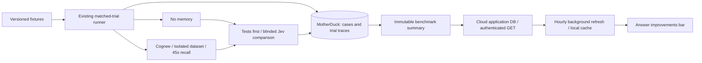

# Offline answer-quality MVP

Run a fixed, versioned benchmark with and without Cognee. Persist evaluation-only
traces and verdicts in MotherDuck, then publish a small authenticated summary for
Claude/Codex to cache. No production conversations are sampled or uploaded by this job.



## Local validation — no paid calls

From the repository root, with Python 3.12 and `duckdb==1.5.4` installed:

```sh
python integrations/evaluation/quality_job.py \
  --suite integrations/evaluation/smoke-suite.json \
  --limits integrations/evaluation/limits.example.json \
  --warehouse /tmp/cognee-eval.duckdb --out /tmp/cognee-eval-run
```

Use a fresh output directory for each run. This runs seven cases, two arms and two
repetitions (28 trials). Smoke summaries are always `pending`, even with perfect
scores; both the CLI and API reject publication as product evidence.

## Live evaluation

`benchmark-suite.json` contains 20 retrieval/answer tasks. Replace
`SET_PINNED_MODEL_VERSION` with the exact model version returned by your provider.
These are curated fixtures, not a representative sample of a user's sessions.
The supplied adapter tests answers and citations, **not full coding-agent tool
execution**. That requires a separate agent adapter and replayable repository fixtures.

Configure a dedicated evaluation tenant and provider accounts. Never inherit the
plugin's production connection implicitly. The job requires:

- `EVAL_COGNEE_BASE_URL`, `EVAL_COGNEE_API_KEY`: evaluation tenant with
  `capture_idempotency_v1` and working dataset creation / typed remember / improve.
- `EVAL_MODEL_URL`, `EVAL_MODEL_API_KEY`: complete OpenAI-compatible completion URL
  and credential; configure `EVAL_INPUT_USD_PER_MILLION` and
  `EVAL_OUTPUT_USD_PER_MILLION` if cost is not returned by the provider.
- `TYPESAFE_API_KEY`: Jev credential. Pin `--judge-model` to an exact model version.
- `EVAL_JUDGE_INPUT_USD_PER_MILLION`, `EVAL_JUDGE_OUTPUT_USD_PER_MILLION`:
  verified rates; judge costs are labeled configured-rate estimates.
- `EVAL_SERVER_USAGE_COMPLETE=true`: set only after checking server accounting
  coverage. Unknown total usage stops the job before further paid work.
- `motherduck_token`: warehouse service credential, scoped to the evaluation database.
- For publication: `EVAL_PUBLISH_URL` (HTTPS tenant API) and `EVAL_PUBLISH_KEY`.
  The latter matches that tenant's `COGNEE_EVALUATION_PUBLISH_KEY`, at least 32 characters.

```sh
python integrations/evaluation/quality_job.py --live --publish \
  --suite integrations/evaluation/benchmark-suite.json \
  --limits integrations/evaluation/limits.example.json \
  --warehouse md:cloud_analytics --out /work/run \
  --judge-model YOUR_PINNED_JEV_VERSION --repetitions 2
```

Two repetitions produce 80 answer trials and at most 40 judge calls. Correctness
checks decide clear wins/losses and both-failed ties without a judge call. Remaining
pairs are judged with variant names hidden and deterministic A/B ordering. Jev's
confidence is not interpreted as a probability of correctness.

The runner refuses a suite whose worst-case reservations exceed configured trial,
token or dollar admission limits. It checks observed usage after each operation;
missing accounting or a reservation overrun stops subsequent work. **These are
admission controls, not a hard provider billing ceiling.** An in-flight provider
or Cognee preparation call can exceed a reservation. Set dedicated provider/tenant
spending caps as well. Total runtime is bounded by the Kubernetes job deadline;
individual trials use the existing 300-second deadline, including a hard 45-second
recall subprocess deadline. Failed/partial jobs never replace the previous summary.

The existing runner retains isolated `eval_*` datasets for inspection; trial rows
record their names. Use the dedicated tenant's retention process before enabling
recurring runs. Evaluation output is never written back as production memory.

## MotherDuck and summary API

The new `quality_eval` schema owns four append-only tables. Every table has an
immutable ID, run ID, creation timestamp and JSON payload:

- `eval_cases`: content-addressed fixture and held-out expected checks.
- `eval_trials`: matched controls, actual adapter answer/context, evidence IDs,
  usage and diagnostics. Arbitrary coding-agent spans require an agent adapter.
- `eval_verdicts`: paired decision, deterministic checks or raw Jev result,
  judge model and configured-rate cost.
- `eval_summaries`: one immutable run summary, with rates and per-arm metrics.

Retries with identical IDs/content are safe; changed content conflicts. A successful live result with identical suite, models, rubric, runner/harness code
and endpoints is reused for 24 hours without model calls. Its original timestamp
is preserved. `--fresh` explicitly bypasses this cache; otherwise a new invocation
after that window starts a new paid run. Output-directory checks
prevent accidental reuse locally; the CronJob has `concurrencyPolicy: Forbid` and
`backoffLimit: 0`. Do not retry a paid job blindly after a partial failure.

The companion cloud-backend change adds an `evaluation_summaries` application table
and `/api/v1/evaluations/summary`:

- `POST`: dedicated publisher Bearer secret, independent of ordinary user API keys.
  Accepts only benchmark-scoped live results; immutable run receipts.
- `GET`: existing Cognee user/API-key authentication. Returns the newest benchmark,
  `pending` when absent, and `stale` after 48 hours. No traces or private fixtures.

Only the small public summary is copied into the application DB. The plugin never
connects to MotherDuck or Jev. Its cloud worker fetches at most hourly with a
three-second timeout; the renderer only reads a tenant-URL-bound local cache.

`improvement_rate = better / all paired comparisons`; ties and regressions stay in
the denominator. A ready score requires at least 20 comparisons and no unjudgeable
pairs. This is a display coverage threshold, not statistical significance; repeated
trials of the same task are not independent tasks. The summary includes unique case
count, model, fixture hash, rubric version and timestamp. Historical results never
claim to grade the current answer or the user's personal tasks.

The stripe replaces its imprint-ratio decoration with the single quality bar.
At narrow widths some counters are omitted. Regressions and the `benchmark` label
remain with a measured percentage; unavailable/stale results show no percentage.
Inspect full cached details without network calls:

```sh
python "$CLAUDE_PLUGIN_ROOT/scripts/_quality_summary.py"
# Codex: python "$PLUGIN_ROOT/scripts/_quality_summary.py"
```

## Deployment

Build from the integration repository root:

```sh
docker build -f integrations/evaluation/Dockerfile -t YOUR_REGISTRY/evaluator:COMMIT .
```

The companion cloud Helm change adds `qualityEvaluation`, disabled by default.
Create a ConfigMap containing the pinned `suite.json` and reviewed `limits.json`,
and a Secret with the environment names above. Set the immutable image, exact judge
model and target warehouse in GitOps; deploy via the existing image/ArgoCD process.
The target tenant needs the new API/migration image and a namespace-local Secret
`cognee-evaluation-publisher` containing `publish-key`. Both tenant chart variants
read this optional Secret. Missing publisher configuration disables writes.

Start with a manual job, inspect results and cost, then enable the daily schedule.
The warehouse stores fixture-generated content only in this MVP. Future personal
trace sampling needs separate consent, bounded replay capture, retention and
propagated deletion; the operational anonymous telemetry pipeline is not reused.
