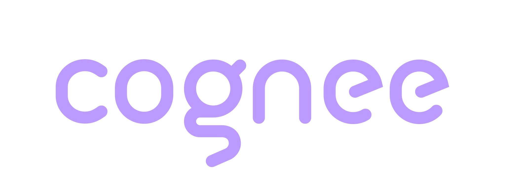

<div align="center">
  <a href="https://www.cognee.ai">
    
  </a>
  <p><strong>Cognee company memory for Paperclip</strong> — completed tasks and recorded decisions become shared, source-linked knowledge that any later agent run can recall.</p>
  <p>
    <a href="https://docs.cognee.ai">Docs</a> ·
    <a href="https://discord.gg/NQPKmU5CCg">Discord</a> ·
    <a href="https://github.com/topoteretes/cognee">Cognee core</a> ·
    <a href="https://github.com/paperclipai/paperclip/blob/master/doc/plugins/PLUGIN_AUTHORING_GUIDE.md">Paperclip plugins</a>
  </p>
</div>

# Cognee Company Memory Plugin for Paperclip

A native Paperclip worker plugin (`cognee.company-memory`). When an agent finishes a task
in an enabled project, the task's outcome is stored in Cognee with a link back to it. When
an agent posts a comment starting with `#remember`, that decision is stored too. Any later
run in the company can call `cognee_recall` and get the evidence with its source tasks,
and `cognee_remember_decision` to record a conclusion of its own. A fresh agent run can use
prior work without the operator pasting it into a prompt.

The first workflow it is built for: research → product decision → marketing brief. One
agent records customer evidence, another makes a decision, a later one retrieves both.
[`examples/research-company/`](examples/research-company/README.md) is that company.

## What it does, and does not do

| Does | Does not |
|---|---|
| Capture **completed** issues (`status: done`) in enabled projects | Ingest full transcripts, model reasoning, or every issue |
| Capture comments that **start with the decision marker** (`#remember` by default) | Crawl the workspace or capture unmarked comments |
| Give agents `cognee_recall` over their project's dataset plus an optional company-shared dataset | Let the model choose a dataset, company, or project |
| Give agents `cognee_remember_decision` tied to an issue in their company and project | Expose deletion, `everything`, or backend credentials to agents |
| Keep a durable ledger of every write with its indexing state | Promise exactly-once delivery across Paperclip and Cognee |
| Retire a replaced source's document (verified) before reporting the replacement | Inject memory into prompts automatically (the skill asks agents to recall) |

## Install

Requires a Paperclip host whose plugin runtime matches
[`COMPATIBILITY.md`](COMPATIBILITY.md) (SDK 2026.1012.0, Node 24.11+) and a Cognee backend
(Cognee Cloud or a self-hosted server, cognee 1.6.5 verified).

```bash
npx paperclipai plugin install @cognee/paperclip-plugin
```

The host validates the manifest, shows the requested capabilities (all read-only on
Paperclip's side plus outbound HTTP, a secret reference, two tools, two jobs, and a plugin
database namespace), runs `migrations/001_memory_ledger.sql`, and starts the worker. For
development, `paperclipai plugin install /absolute/path/to/integrations/paperclip` after
`npm run build`.

**Native connector mode.** Paperclip also ships an experimental Cognee *memory connection*
(Settings → Experimental → Memory connectors) with tool-driven `remember` / `recall` /
`forget` and no automatic capture. That is a different installation path with its own
credentials; the plugin never reads or borrows them. Use the native connection for a quick
tutorial; use this plugin for automatic capture, provenance, scoping and a ledger.

## Configure

Open the plugin's settings in Paperclip. Everything is instance configuration; the plugin
reads no environment variables.

| Setting | Required | Purpose |
|---|---|---|
| `cogneeBaseUrl` | yes | Cognee Cloud tenant URL or self-hosted server |
| `cogneeApiKeyRef` | yes | A Paperclip **secret reference** holding the cognee API key. Resolved at call time through `ctx.secrets`, never cached or logged |
| `enabledCompanyIds` | yes | Companies the plugin may capture from and recall for. An instance-wide install enables nobody by default |
| `enabledProjectIds` | for capture | Projects whose completed issues and marked comments are captured. Each gets its own dataset |
| `companySharedDataset` | no | One cognee dataset every enabled project can read. Read-only for agents; the plugin never writes there |
| `captureMode` | no (`both`) | `completed_issues`, `marked_comments`, `both`, or `off` |
| `decisionMarker` | no (`#remember`) | A comment captured as a decision starts with this token followed by whitespace or the end of the comment |
| `paperclipPublicUrl` | recommended | Base URL used to build links in stored records |
| `issueLinkTemplate` | advanced | `{publicUrl}/issues/{issueId}` by default; placeholders `{companyId}`, `{projectId}` available |
| `instanceKey` | advanced | Mixed into dataset names so two instances on one tenant never collide |
| `maxRecordChars`, `recallTopK`, `maxRecallChars`, `recallTimeoutMs`, `writeTimeoutMs`, `maxDrainBatch` | advanced | Size and time budgets |

**Test connection** (`onValidateConfig`) parses the settings, resolves the secret, and
calls the backend's `/health` and dataset list. Capture never starts on an invalid
configuration.

### Datasets and isolation

Each enabled project writes to its own dataset named `pc_<sha256(instanceKey, companyId,
projectId)[:16]>`. A run's `cognee_recall` reads that dataset and, when configured, the
company-shared one. Dataset naming is organisation, not authorisation: the plugin enforces
its allowlists, and the backend API key's own permissions apply on top. Restrict the key on
the backend where supported, and run one plugin configuration per isolation boundary.

## What agents see

| Tool | Inputs | Behaviour |
|---|---|---|
| `cognee_recall` | `query`, optional `limit` | Searches the run's permitted datasets (`CHUNKS`, graph scope), returns bounded passages with the source task and link. `empty` and backend `unavailable` are reported distinctly |
| `cognee_remember_decision` | `content`, optional `rationale`, `source_issue_id` | Verifies the issue is in the run's company, in an enabled project, and in the run's project; stores a provenance-stamped decision; returns a receipt and whether it is stored, queued, or indexing |

Company and project come from the host's run context, never from the model. Unknown fields
in the parameters are ignored.

[`skills/company-memory/SKILL.md`](skills/company-memory/SKILL.md) teaches agents when to
recall (before research or planning), when to save (conclusions with evidence, after work),
and to treat recalled text as evidence rather than instructions.

## The ledger

Every capture is a row in the plugin's database namespace before anything is sent.

| Status | Meaning |
|---|---|
| `pending` | Queued; sent by the event handler right away, or by the `drain-outbox` job (every 5 minutes) |
| `accepted` | The backend stored the upload; graph indexing not yet confirmed |
| `indexing` | Document listed in the dataset; the cognify pipeline is running |
| `ready` | Indexed; `cognee_recall` can return it |
| `uncertain` | The write timed out or lost the connection. `reconcile-sources` (hourly) looks for the document by its upload name; after 15 minutes without it, the same content is resent (identical content is a no-op on the backend) |
| `failed` | Rejected (401/403/400) or gave up after repeated transient errors; an operator inspects |
| `conflict` | Backend 409, or a retirement/cleanup whose document is still listed afterwards; stops retrying and needs reconciliation |
| `superseded` | An older revision of an edited source, awaiting verified retirement |
| `retired` | Deleted on the backend and verified absent; local content cleared |
| `revoked` | Never sent: cleanup or a disabled project revoked it |

**Edits.** When a captured issue or comment changes, the new revision is queued and the
previous document is deleted and verified gone *before* the new one is sent. If the old
document cannot be removed, the replacement is held and the source shows as `conflict`
rather than two contradictory records contributing to recall.

**Deleted sources.** `reconcile-sources` re-reads each `ready` issue/comment through the
host and retires records whose source no longer exists.

**Health.** `onHealth` reports `degraded` whenever `conflict` or `failed` rows exist, with
counts and the last drain/reconcile summaries; the `memory-health` data key exposes the same
for UI.

## Operator actions

| Action | Params | Effect |
|---|---|---|
| `sync-project` | `projectId` | Queue every `done` issue of an enabled project (backfill or re-sync) and send |
| `cleanup-scope` | `projectId`, `confirm: true` | Revoke every queued or pending write for the project first, then delete every plugin-owned document in the project's dataset and verify by re-listing. Only that project's dataset is touched; the shared dataset is never written or cleaned by the plugin |

Uninstalling the plugin disables capture and leaves remote data intact; run `cleanup-scope`
per project first if you want it removed.

## Limitations

- Verified with the SDK's in-memory host harness and a live cognee 1.6.5 server, **not yet
  on a real Paperclip host or with real agent adapters** — see `COMPATIBILITY.md` for the
  exact findings, including the event-payload and link-route assumptions to confirm.
- Scheduled jobs carry no company id; the plugin snapshots everything it needs at event
  time and resolves config and secrets per company when a job runs.
- Runtime plugin installation currently suits single-node persistent Paperclip deployments.
- No automatic prompt injection: agents must call the tools (the skill asks them to).

## Development

```bash
npm install
npm test            # build (tsc + esbuild bundles) and run the harness suite
npm run typecheck
COGNEE_BASE_URL=http://127.0.0.1:8000 COGNEE_API_KEY=... npm run test:live   # disposable dataset on a real server
npm pack --dry-run  # manifest, worker, migrations, skill, examples, docs; no tests or fixtures
```

Layout: `src/manifest.ts`, `src/worker.ts` (entrypoint), `src/plugin.ts` (wiring),
`src/capture.ts` (events), `src/outbox.ts` + `src/ledger.ts` (durable ledger),
`src/tools.ts`, `src/scope.ts`, `src/config.ts`, `src/cognee-client.ts`, `src/records.ts`.
Changes are in [`CHANGELOG.md`](CHANGELOG.md).
